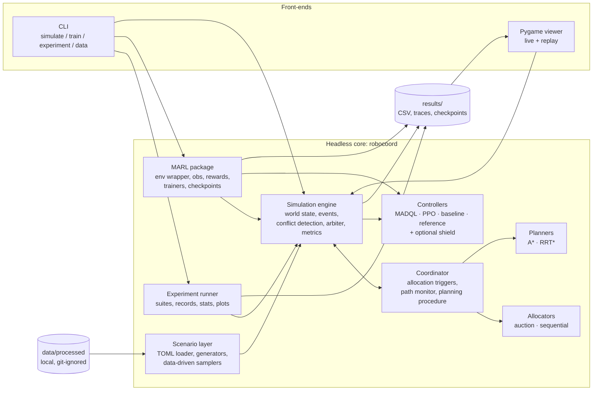

# 03 — System Architecture and Technical Decisions

| Field | Value |
|---|---|
| Document role | **Source of truth for architecture, technology stack, interfaces, repository layout and design decisions (ADRs).** |
| Status | Revision 2 (Issue #1, after design review; changes in `verification-log.md` V-1) |
| Depends on | `01-requirements.md` (what), `02-mathematical-model.md` (formal definitions and guarantees, §12) |

---

## 1. Architectural overview

The system is a **headless simulation core** surrounded by thin front-ends. Coordination follows a **three-level hierarchy** that mirrors the specification's three algorithm families:

| Level | Decision | Algorithm (selectable) | Frequency |
|---|---|---|---|
| Strategic | *Which robot does which task?* | Auction (Bertsekas ε-scaling), sequential auction baseline | Event-driven |
| Tactical | *Which reference route should the robot follow?* | A\*, RRT\* | Event-driven (path monitor) |
| Operational | *What does the robot actually do this step?* | MADQL, PPO (MAPPO/IPPO), rule-based baseline, reference follower (diagnostic) | Every step |

Below the operational level sit the **execution layers**: action mask, optional safety shield and arbiter (ADR-10). Guarantees are scoped per level:
- the strategic and tactical levels provide algorithmic guarantees *for their own sub-problems and snapshots*;
- the execution layers guarantee the physical invariants;
- **nothing guarantees end-to-end optimality or task completion** (model §5.5, §12).



Two dependency rules hold, enforced by the package layout and checked in review:
1. **Algorithms never import front-ends** (NFR-MAINT-2). The viewer only reads engine state or recorded traces.
2. **Algorithms do not depend on each other.** Planners do not know about RL; allocators do not know about planners. They depend only on `core` types and receive data through small query objects. The coordinator and the engine compose them.

---

## 2. Simulation step pipeline

One engine step performs the transition $\mathcal{T}$ of model §6 in this fixed order:

```mermaid
sequenceDiagram
    participant E as Engine
    participant W as World state
    participant C as Coordinator
    participant A as Allocator
    participant P as Planning procedure (A*/RRT*)
    participant K as Controller
    participant S as Shield (optional)
    Note over E: step t
    E->>W: 1. apply events due at t (task releases, map events with deferral)
    E->>W: 2. dynamic obstacles propose and resolve moves (fixed order) → z(t+1), hidden from controllers
    E->>C: 3. on_world_changed(events)
    C->>A: 3a. if allocation trigger: allocate(problem)
    A-->>C: assignment (goal changes → trigger T1)
    C->>P: 3b. robots with triggers T1–T8: plan(query) via shared constraints + two-stage procedure
    P-->>C: PlanResult (path | status, degraded, stats)
    E->>K: 4. observations + masks (incl. suggested action) → act()
    K-->>E: raw joint proposal a^ctrl
    E->>S: 5. shield (if enabled) → a^arb, interventions
    E->>W: 6. detect_conflicts(a^arb) → events; arbitrate → x(t+1); assert no physical collision
    E->>E: 7. detect_conflicts(a^ref) and (a^ctrl) for counterfactual metrics (no state change)
    E->>W: 8. pickups, deliveries, task status, rewards (base + shaping)
    E->>C: 9. path monitor: rejoin / deviation / stall bookkeeping
    E->>E: 10. metrics update, trace record
```

Design notes:
- **Obstacles move independently of robot actions at $t$.** At step 4 the controller sees $z_k(t)$ and velocities but not $z_k(t+1)$. Because $z(t+1)$ does not depend on the robots' actions, the counterfactual conflict sets in step 7 are exact (model §9.2).
- In the RL loop the controller is *outside* the engine. `MultiRobotEnv` (§5.6) runs steps 1–3, builds the observations and masks of step 4, returns them, receives the actions, and runs steps 5–10. Interactive and experiment loops call the controller themselves. Both share one engine code path.
- **Allocation triggers:** task released, task delivered, robot became idle, a plan status became `unreachable`, map event. Several triggers in one step cause a single auction.
- **Replanning triggers** T1–T8 (model §5.4) are evaluated in step 3b. At most one planner call per robot per step. T7 (deadlock detour) occurs only with the opt-in resolver and T8 (endpoint recovery) only with endpoint recovery enabled; both change monitor goals only.

---

## 3. Technology stack

### 3.1 Selected stack

| Concern | Choice | Why this fits *this* project |
|---|---|---|
| Language | **Python 3.12–3.14** | Binding decision D-1. 3.12+ provides `tomllib`, modern typing and faster CPython. Supported versions are those passing the CI matrix (§3.3). Python 3.14-compatible releases of torch, numpy and pygame-ce were seen on PyPI on 2026-11-17. Installation is verified for NumPy and SciPy (Issues #2–#4) and for torch 2.15.0+cpu on Windows 11 / Python 3.14.3 (`verification-log.md` V-12); pygame-ce is not yet verified (Issue #8). |
| Numerics | **NumPy** | Occupancy grids, distance fields, observation tensors, vectorised geometry, the brute-force neighbour index and the k-d tree build (`argpartition`). Seeded `numpy.random.Generator` streams. |
| Deep learning | **PyTorch (CPU), optional extra `marl`** | Not a base dependency (§3.4). Small MLPs (~10⁵ parameters). Explicit training loops written by us, so the algorithms are not hidden in a library. CPU is sufficient (NFR-PERF-3). |
| Scientific utilities | **SciPy** | `linear_sum_assignment` (Hungarian) as an **independent oracle** for the auction. Statistical tests (Wilcoxon) and bootstrap utilities. SciPy's `cKDTree` is **not** used inside RRT\*; see §3.2. |
| Results handling | **pandas** | Aggregating per-run records in the experiment/analysis layer only. |
| Plots | **Matplotlib** | Static figures for the report. |
| Visualisation | **pygame-ce** | Real-time 2-D rendering, keyboard/mouse control, frame stepping, offline. The actively maintained community fork. |
| Configuration | **TOML via `tomllib`** + frozen `dataclasses` with explicit validation | Human-readable, no extra dependency. Errors name the offending field. |
| Testing | **pytest**, **Hypothesis**, **pytest-cov** | Property-based tests against independent oracles. |
| Quality | **ruff** (lint + format), **mypy** | NFR-MAINT-1. |
| Packaging | `pyproject.toml` (PEP 621), `src/` layout, `venv`, editable install; `requirements-lock.txt` (base) and `requirements-lock-marl.txt` (MARL add-on, §3.4) | Standard and reproducible. |
| Kaggle access | Kaggle CLI/API (optional extra) or manual browser download | Downloads use the student's own account. Preprocessing is pure Python/pandas. |

### 3.2 Alternatives considered

| Decision | Alternative | Why not chosen |
|---|---|---|
| UI | Streamlit | Its rerun model is unsuited to smooth real-time animation and step control. |
| UI | Web front-end (FastAPI + JS canvas) | Two languages and a WebSocket protocol for no algorithmic benefit. Traces (ADR-7) keep this option open. |
| UI | Matplotlib animation | Slow redraws, weak interactivity. |
| RL framework | Stable-Baselines3 / RLlib | SB3 is single-agent. RLlib is heavy and hides the algorithms. |
| MA env API | PettingZoo dependency | We mirror its `ParallelEnv` method names but avoid a hard dependency for one environment. |
| RRT\* neighbour index | **Fixed-bucket spatial hash** | Rejected in revision 2. With a fixed bucket size in a bounded domain, bucket occupancy grows linearly with $n$, so queries cost $\Theta(n)$ and the earlier $O(\log n)$ claim did not hold (`04-algorithms.md` §3.2). |
| RRT\* neighbour index | SciPy `cKDTree` rebuilt per insertion | $O(n \log n)$ per insertion. Its split rule (maximum spread) also does not match the alternating-split assumption of the range-query bound we cite. We implement our own static alternating-median 2-d tree inside the Bentley–Saxe logarithmic method, plus a vectorised brute-force index as oracle and small-$n$ option. |
| Acceleration | Numba / Cython | Premature, and Cython conflicts with the Python-only intent. Profiling in Issues #3–#4 decides. |
| Config | YAML / Hydra | Extra dependencies; TOML is in the standard library. |

### 3.3 Continuous integration (decision 9)

`.github/workflows/tests.yml` (created in Issue #2) runs on every push and pull request:

| Job | Matrix | Steps |
|---|---|---|
| `quality` | ubuntu-latest × Python 3.14 | `ruff check .`, `ruff format --check .`, `mypy src/robocoord` |
| `tests` | ubuntu-latest × Python {3.12, 3.13, 3.14}; windows-latest × Python 3.14 | `pip install -e ".[dev,marl]" --extra-index-url https://download.pytorch.org/whl/cpu`, a check that `torch.version.cuda is None`, `pytest` (fast suite only); see §3.4 |

Slow, training and e2e tests run locally before an issue is closed (`05` §A.5), not in CI. CI results are recorded in the verification log by the student's report or a screenshot. Claude cannot see GitHub-hosted runs unless the student shares them.

**Dependency versions: what CI and the local environment share (Issue #4).**
- CI installs from `pyproject.toml` (`.[dev]` in the `quality` job, `.[dev,marl]` with the CPU index in the `tests` job); the local environment installs from `requirements-lock.txt`. Test tooling that affects test behaviour is pinned **exactly** in `pyproject.toml`, so both resolve the same version: `hypothesis==6.155.7` and `scipy==1.18.1`.
- **NumPy is deliberately not identical.** The package declares `numpy>=2.0` (a runtime dependency for users), so CI resolves the newest release (2.5.5 at the time of writing). The lock file pins 2.4.6, because Windows Application Control on the development machine blocks NumPy 2.5.5's `random/_philox` extension (Issue #2). This is an OS-policy constraint, not a compatibility one. Both versions satisfy the declared range, and CI therefore also exercises a second NumPy version.
- **Effect on results:** tests compare runs within one environment, so determinism tests (X-1) are unaffected. Recorded experiments run locally, and every run directory stores its NumPy version in `env.json`. Cross-version bit-identity of `Generator` sampling methods is not assumed: NumPy guarantees stream compatibility for its bit generators, not for every sampling method. Numbers are therefore reproducible with the lock file, not necessarily with another NumPy release.

### 3.4 Optional dependencies and installation (Issue #5)

PyTorch is **not** a base dependency. `pyproject.toml` declares it as the optional extra `marl` (`torch==2.15.0`). The only base runtime dependency stays `numpy>=2.0`.

**Why the base stays independent of PyTorch.** The simulator (`core`, `world`, `scenario`, `sim`), the planners (`planning`), the allocators (`allocation`) and the non-learned controllers (`control`) are the environment from the learner's point of view (ADR-2). They run on NumPy alone, and no module outside `robocoord.marl` imports torch. Only the learned part (`marl`, Issues #5–#6) needs it. A base installation therefore stays small, does not depend on torch wheel availability, and runs the whole Issue #2–#4 test suite and experiments (E1–E3 and the Issue #4 non-learned system runs). *Design rule for Issue #5, implemented:* torch is imported at module level only by `marl/{networks,madql,checkpoint,policy,trainer}.py`, and lazily by `marl/evaluation.py` (learned controllers only) and by the CLI's `madql` and `train` paths. Without the extra, the CLI reports a configuration error naming the install command (exit code 2). The NumPy-only `marl` modules (`config`, `observation`, `reward`, `global_state`, `scenarios`, `env`, `vector_env`, `replay`) import without torch. Tests that need torch use `pytest.importorskip("torch")`, so a base installation still passes its own tests.

**Supported installation commands** (inside a virtual environment):

| Purpose | Command |
|---|---|
| Base | `pip install -e .` |
| Development | `pip install -e ".[dev]"` |
| MARL, CPU-only PyTorch | `pip install -e ".[marl]" --extra-index-url https://download.pytorch.org/whl/cpu` |
| Development + MARL (what CI runs) | `pip install -e ".[dev,marl]" --extra-index-url https://download.pytorch.org/whl/cpu` |
| Base lock (exact versions, no PyTorch) | `pip install -r requirements-lock.txt -e .` |
| MARL lock (exact versions, CPU-only PyTorch) | `pip install -r requirements-lock-marl.txt -e ".[marl]"` |

`pip install -e ".[marl]"` **without** the CPU index is not supported (next paragraph).

**Why the CPU index is required.** The learned controllers train on the CPU (NFR-PERF-3), so no GPU libraries are needed. The PyPI wheel of torch 2.15.0 for Linux declares dependencies on `cuda-toolkit==13.2.2`, `nvidia-cudnn-cu13`, `nvidia-nccl-cu13`, `nvidia-nvshmem-cu13`, `nvidia-cusparselt-cu13`, `cuda-bindings` and `triton` (read from the PyPI metadata of 2026-11-19; the download size was not measured). The PyPI wheel for Windows has no such dependency. The PyTorch CPU index (`https://download.pytorch.org/whl/cpu`) serves `torch-2.15.0+cpu`, whose Linux wheel lists none of them. The local version tag `+cpu` sorts above `2.15.0`, so with `--extra-index-url` pip prefers it on both platforms, and the extra's `torch==2.15.0` accepts it (PEP 440). `pyproject.toml` cannot carry an index URL for pip, which is why the flag appears in the commands above, in the lock file and in CI.

**`requirements-lock-marl.txt`.** It is an add-on to `requirements-lock.txt`, not a copy. It starts with the CPU index line and `-r requirements-lock.txt`, then pins `torch==2.15.0+cpu` and torch's eight dependencies (`filelock`, `fsspec`, `Jinja2`, `MarkupSafe`, `mpmath`, `networkx`, `setuptools`, `sympy`). The base lock stays free of PyTorch, and NumPy, SciPy and Hypothesis keep one source of truth. Because the index line applies to the whole pip invocation, `-e ".[marl]"` resolves to the pinned `2.15.0+cpu` and never to a second torch build.

**CI.** The `tests` job installs `.[dev,marl]` with the CPU index and then runs `python -c "import torch; assert torch.version.cuda is None"`, which fails if a CUDA build was installed. The `quality` job keeps `.[dev]` until `src/robocoord/marl` imports torch. It then also needs `marl`, so that mypy resolves the torch types.

**Verification status** (`verification-log.md` V-12). torch 2.15.0+cpu was installed and exercised on Windows 11 / Python 3.14.3 only. Linux and Python 3.12/3.13 were checked by dry-run resolution and wheel metadata, not by installation. The CI workflow with the new steps has not been run yet.

---

## 4. Architecture Decision Records (ADRs)

Each ADR is written once. Later issues reference it rather than re-deciding.

### ADR-1: Discrete grid world with a continuous embedding

- **Decision.** The world is a 4-connected occupancy grid, and robots move one cell per step. The grid is embedded in $\mathbb{R}^2$ (cell = unit square) so that RRT\* plans in continuous space over the same map.
- **Consequences.**
  - A\* is exactly optimal on the lattice. RRT\* is faithful in continuous space.
  - Discretisation is an explicit, tested step.
  - Continuous and lattice feasibility coincide under the supercover rule (model Lemma 5.1).
  - Planner comparisons report both the lattice $\kappa$-cost and the continuous (weighted) length of both planners' outputs (`05` E1).

### ADR-2: Hierarchical integration of allocation, planning and learning

- **Decision.** The auction assigns tasks and the planner provides a reference path. The MARL policy chooses the primitive action each step from a local observation that includes the planner's suggested action, and may deviate from it.
- **Alternatives.**
  1. End-to-end RL: the planner would be decorative and long-horizon learning is sample-inefficient.
  2. RL selects planner or task: discards the allocation and planning guarantees.
  3. Planner only, RL as tie-breaker: RL's role would be too small to show cooperation.
- **Justification.** Each algorithm does what it is provably good at. RL learns decentralised, cooperative conflict avoidance under partial observability, which has no clean closed-form solution.
- **Consequences and limits (revision 2).**
  - Planner optimality and completeness are **snapshot properties of the reference path**. They do not transfer to executed trajectories or task completion (model §5.5, G15).
  - The path monitor is controller-agnostic and handles deviations (T3) and stalls (T4).
  - Adherence and counterfactual metrics (model §9.2–9.3) quantify how controllers use or improve on the reference.
  - The reference follower and the rule-based baseline are the natural ablations.

### ADR-3: MADQL variant

- **Decision.** **Parameter-shared independent Double DQN with team-mixed rewards and action masking**: one shared Q-network, a common replay buffer of per-robot transitions, Double-DQN targets and a target network.
- **Rationale.** The canonical multi-agent DQN form (Tampuu et al. 2017; Gupta et al. 2017). It is size-independent.
- **Known limits.** Non-stationarity; no convergence guarantee (G16).
- **Fallback.** VDN may be *added* if MADQL learns poorly in Issue #5. It never replaces this variant.
- *Issue #5/#6 outcome:*
  - MADQL completed fewer tasks than both non-learned controllers on validation block B (`05` §B.6).
  - The student **deferred VDN** (2026-11-20): PPO is implemented and compared first, and VDN or other changes are revisited only if PPO is also unsatisfactory.
  - VDN is not implemented.

### ADR-4: PPO variant

- **Decision.** Shared stochastic actor. A centralised critic on $[o_i, \phi(s)]$ (MAPPO, Yu et al. 2022) or a local critic on $o_i$ (IPPO, de Witt et al. 2020), selected by a flag.
- **Rationale.** CTDE: execution needs only local observations.
- *Implemented in Issue #6* (`marl/ppo.py`, `marl/rollout.py`, `marl/ppo_trainer.py`):
  - one PPO core;
  - the `variant` flag (`mappo` | `ippo`) changes only the critic's input ($[o_i, \phi(s)]$, 615, or $o_i$, 356) and its width;
  - actor and critic are each shared by all robots;
  - no robot identity, so team sizes may vary.
  - Details in `04` §7 notes.

### ADR-5: Auction allocator

- **Decision.** Bertsekas' forward auction with ε-scaling, implementing **weighted priority** (model §8.1). Baselines and references:
  - sequential single-item auction as the baseline;
  - SciPy Hungarian as test and experiment oracle only.
- **Rationale.** Genuinely market-based (prices, bids, equilibrium), with a provable optimality bound, defined complexity, and natural distributability.
- **Consequences (revision 2).**
  - The allocation is optimal *for the weighted objective* and guarantees maximum cardinality (G10).
  - It does **not** guarantee strict priority precedence (G11) or starvation freedom (G13). Aging is a mitigation, validated in E3.
  - *Issue #4 outcome:* implemented as specified.
    - E3a: optimal on all 280 ε-scaling solves.
    - E3b: κ > 0 lowers $F_w$ and top-level flow time, with clear paired differences.
    - In wall time the exact Python auction is 7–11× slower than SciPy's compiled Hungarian at k = 400, and more at small k, so hypothesis H2's "competitive" part is not supported (`05` §B.6).

### ADR-6: In-house multi-agent environment API

`MultiRobotEnv` provides:
- `reset(seed) -> (obs: dict[int, ndarray], info)`;
- `step(actions: dict[int, int]) -> (obs, rewards, terminated, truncated, info)`, i.e. PettingZoo-Parallel-style dictionaries with Gymnasium's termination/truncation semantics;
- `action_masks()` and `global_state()`.

`SyncVectorEnv` batches $E$ copies.

### ADR-7: Visualisation decoupled through traces

The engine emits a JSON-Lines trace per step (positions, events, conflict sets, assignments, paths, metrics). The Pygame viewer has a live mode and a replay mode.

### ADR-8: Determinism and seeding

- One master seed per run. Named child streams come from `numpy.random.SeedSequence(master).spawn` in a fixed order: `map`, `obstacles`, `tasks`, `planner`, `policy`, `torch`.
- Torch uses `torch.manual_seed`, `torch.use_deterministic_algorithms(True)` in tests, and one intra-op thread for timing runs.
- Scenario instances are identical across algorithm comparisons, which enables paired statistics.

### ADR-9: Data, results and model-artefact policy (revised per decisions 8 and 10)

- **Datasets.** Raw *and derived* Kaggle data are **not committed** by default. `data/raw/` and `data/processed/` are git-ignored.
  - Committed: acquisition and preprocessing code, dataset **manifests** (`data/manifests/*.json`: source, licence, download date, file hashes, row counts, filters, parameters), attribution, and small **synthetic** test fixtures (`tests/fixtures/data/`) in each dataset's schema.
  - Redistribution of any derived data is considered only after verifying the dataset's licence and terms, and with the student's explicit approval.
- **Results.** Runs, traces, figures and test reports go to `results/` (git-ignored). Curated summaries are recorded in the documentation.
- **Model checkpoints.** Final trained policies may be committed to `models/` if each file is **< 5 MB** and contains **inference-only weights** (actor or Q-network `state_dict`; no optimiser state, replay buffer or critic unless needed for evaluation). Each checkpoint has a JSON sidecar with:
  - algorithm and variant;
  - model, observation and reward specification versions;
  - training config hash and full config;
  - seeds;
  - environment steps;
  - validation score;
  - experiment ID and code version.

  Training checkpoints with optimiser state stay in `results/`.

### ADR-10: Execution layers and safety semantics (new in revision 2)

- **Decision.** Every controller's action passes through three layers:
  1. an **always-on action mask** (static feasibility only);
  2. an **optional predictive shield** (`shield = "off" | "predictive"`; off in training and in main experiments, evaluated as an ablation);
  3. the **always-on arbiter**, which cancels conflicting moves (emergency stop).
- **Rationale.**
  - Masking only static infeasibility leaves dynamic-safety decisions to the policy, which is what RL should learn.
  - The arbiter guarantees physical invariants for any controller (G1), so learned policies can never corrupt the simulation.
  - The shield shows what a simple rule-based safety layer adds.
- **Consequences.**
  - Safety is measured by **proposed conflicts** and the counterfactual avoided/introduced sets, not by physical collisions, which are 0 by construction and serve as an invariant check (model §9.2).
  - Conflict events are recorded as sets keyed by (step, type, entities).
  - *Issue #4:* the shield is implemented (`control.shield`) and applied at engine step 5.
    - The X-10 counterfactual categories are defined in model §9.2.
    - The coordinator-level deadlock resolver (`04` §5.5) sits *above* these layers. It changes only planner goals, so the mask, shield and arbiter semantics are unchanged.

---

## 5. Components and interfaces

The signatures below are the *planned contracts*. Names may be refined in the implementing issue, but responsibilities are fixed here.

### 5.1 `core`: shared types and grid primitives (Issue #2)

```python
Cell = tuple[int, int]
class Action(IntEnum): STAY=0; UP=1; DOWN=2; LEFT=3; RIGHT=4
class OccupancyGrid:            # static occupancy; set_blocked() bumps .version
    def is_free(self, c: Cell) -> bool: ...
    def neighbors(self, c: Cell) -> Iterator[Cell]: ...
def bfs_distance_field(grid: OccupancyGrid, target: Cell) -> np.ndarray   # int32, -1 unreachable
class DistanceOracle:           # LRU cache keyed by (target, grid.version); capped distance helper
    def distance(self, a: Cell, b: Cell) -> int | None: ...
def load_movingai_map(path) -> OccupancyGrid; def save_movingai_map(grid, path) -> None
```

**Project Issue #4 NFR-PERF-1 follow-up (`04` §2.1).** `DistanceOracle` additionally caches, per grid version, the free-neighbour lists of the flat BFS (O1) and the component labels behind `reachable()` (O2), and `distance()` reuses a cached field of either endpoint (symmetry). The API is unchanged. `DistanceOracle(grid, legacy=True)` and the context manager `legacy_distance()` select the pre-optimisation behaviour; they exist only for the equivalence tests and the paired before/after benchmark.

### 5.2 `world` and `scenario` (Issue #2)

- Entities and the task state machine; illegal transitions raise `InvalidTransitionError`.
- Task *availability* (model §4).
- `MotionModel.propose(...)`; `ArrivalProcess.releases(t, rng)`.
- Map events with the deferral rule.
- `ScenarioSpec`: loaded from TOML, validated, plus synthetic generators.

### 5.3 `sim`: engine, conflicts, metrics, traces (Issue #2)

```python
def detect_conflicts(state: WorldView, proposal: Mapping[int, Action], obs_next) -> frozenset[ConflictEvent]
def arbitrate(state: WorldView, proposal, events) -> Resolution     # positions, frozen, blocked
class Engine:
    def reset(self) -> WorldView
    def prepare_step(self) -> WorldView                               # pipeline steps 1–3
    def apply_actions(self, actions: Mapping[int, Action]) -> StepOutcome   # steps 5–10
class MetricsRecorder: ...       # model §9, including event-set counterfactuals
class TraceWriter: ...
```

`ConflictEvent` is a frozen dataclass `(t, kind, entities)`. `WorldView` is read-only.

**Coordinator contract (as implemented in Issue #2).** The engine composes the strategic and tactical layers behind one protocol, so the auction (Issue #4) and the planners with their path monitor (Issue #3) plug in without engine changes:

```python
class AssignmentAPI(Protocol):            # implemented by Engine; passed to every coordinator call
    oracle: DistanceOracle                # shared cached BFS distances (benefits, reachability)
    streams: SeedStreams                  # named random streams; planners use streams.generator("planner")
    def assign_task(self, robot: int, task: int) -> None     # state-machine checked
    def unassign_task(self, robot: int) -> None
class Coordinator(Protocol):
    name: str
    def reset(self, view: WorldView, api: AssignmentAPI) -> None
    def update(self, view: WorldView, api: AssignmentAPI) -> None          # pipeline step 3
    def suggested_actions(self, view: WorldView) -> Sequence[Action] | None  # planner advice, or None
```

`Controller.act(view, observations)` is the operational-level protocol. Known additive extension points, not defects: `WorldView` will gain the reference-path data needed by the RL observation (Issue #3/#5), and the shield (Issue #4) slots into the existing pipeline step 5.

*Implemented in Issue #5:* `Engine(..., view_extras={"paths", "goal_distance"}, path_limit=L)` adds two opt-in fields to the view a controller acts on (and only to that view): `WorldView.reference_paths` (each robot's remaining reference path `c_ℓ, …, c_{ℓ+L}`, read through the optional coordinator protocol `PathReporting`, `None` without a valid plan) and `WorldView.goal_distance` (the capped static distance $\bar D(x_i, g_i)$, `None` when idle). They are off by default; requesting them has no side effect: traces and metrics are byte-identical with and without them (tested with A\* and RRT\*, `tests/integration/test_view_extras.py`). The engine itself gained no other API.

### 5.4 `planning`: constraints, procedure, A\*, RRT\*, monitor (Issue #3)

```python
@dataclass(frozen=True)
class PlanConstraints:            # built ONCE per query by build_constraints(); shared by A* and RRT*
    static: OccupancyGrid
    dynamic_blocked: frozenset[Cell]      # B_i: (Z_i ∪ Ẑ_i) minus start and goal
    proximity: frozenset[Cell]            # Q_i (empty if nothing sensed)
    lambda_prox: float

@dataclass(frozen=True)
class PlanQuery:  start: Cell; goal: Cell; constraints: PlanConstraints; rng: np.random.Generator
@dataclass(frozen=True)
class PlanResult:
    path: tuple[Cell, ...] | None
    cost: float
    status: Literal["ok", "unreachable", "budget_exhausted", "invalid_query"]
    degraded: bool                        # True if produced by the static fallback stage
    stats: PlanStats                      # expansions / iterations, k, k', propagation work, time_s, trigger

class Planner(Protocol):
    name: str
    def plan(self, query: PlanQuery) -> PlanResult: ...
def plan_with_procedure(planner: Planner, query: PlanQuery) -> PlanResult   # model §5.3, identical for all planners

class NeighborIndex(Protocol):            # RRT* only
    def insert(self, p: np.ndarray) -> int: ...
    def nearest(self, q: np.ndarray) -> int: ...
    def radius(self, q: np.ndarray, r: float) -> np.ndarray: ...
class PathMonitor: ...                    # triggers T1–T8, rejoin, stall block list
```

**As implemented in Issue #3** (names refined, responsibilities unchanged):
- `planning/base.py`: `PlanConstraints(static, dynamic_blocked, proximity, lambda_prox)` (cached flat views `free_flat`, `penalised_flat`), `PlanQuery`, `PlanResult(path, cost, status, degraded, stats, waypoints)`, and `PlanStats` (the work counters of `04` §2.3 and §3.6, with optional per-iteration traces). The `Planner` protocol adds `decides_reachability`, so the procedure knows when to run the BFS guard.
- `planning/constraints.py`: `build_constraints(grid, start, goal, obstacles, params, extra_blocked)` and `ConstraintParams(sensing_radius=3, inflation_radius=1, lambda_prox=2.0)`.
- `planning/procedure.py`: `plan_with_procedure(planner, query, static_reachable=None)`.
- `planning/astar.py`, `planning/rrtstar.py` (`RRTStarConfig`), `planning/geometry.py`, `planning/neighbors.py` (`NeighborIndex` protocol with `insert(x, y)`, `nearest(x, y)`, `radius(x, y, r)`, `BruteForceIndex`, `make_index`), `planning/kdtree.py` (`StaticKDTree`, `LogKDTreeIndex`).
- `planning/monitor.py`: `PathMonitor`, `MonitorParams(validity_horizon=5, rejoin_window=3, cooldown=3, stall_threshold=4)`, `PlanCall`.
- `planning/coordinator.py`: `PlanningCoordinator(planner, assignments)`. It combines fixture assignments (until the Issue #4 allocator), the path monitor and the release/hold policy.
- `sim/coordinator.py` gains the optional `PlanReporting` protocol (`plan_valid`, `trace_fields`, `episode_stats`, `finish`). The engine uses it for plan adherence, the `"plans"` trace field and `EpisodeMetrics.extra["planning"]`. This is additive; earlier coordinators are unchanged.

**Goal overrides (Project Issue #4).** Two coordinator-level components may replace, for one robot at a time, the goal the path monitor plans to; neither ever chooses an action.
- `planning/deadlock.py`, `DeadlockResolver` (T7): robot–robot wait-for cycles (`04` §5.5).
- `planning/endpoint.py`, `EndpointRecovery` (T8): parking of idle robots on active task endpoints and retreat from a persistently held task goal (`04` §5.6).

`AllocationCoordinator(..., deadlock=..., endpoint=...)` composes them: the resolver's overrides come first, endpoint recovery skips robots the resolver overrides, and both reach the monitor through `RobotInput(goal, detour, hold_stall, avoid, trigger, count_active)`. The CLI (`--deadlock`, `--endpoint`), the `system_episode` experiment executor (`fixed.endpoint`) and the benchmark set the system defaults; the bare constructor keeps both opt-in.

### 5.5 `allocation` (Issue #4)

```python
@dataclass(frozen=True)
class AllocationProblem: robots: Sequence[int]; tasks: Sequence[int]; benefit: np.ndarray  # -inf = infeasible
class Allocator(Protocol):
    name: str
    def allocate(self, problem: AllocationProblem) -> AllocationResult
def build_benefits(world: WorldView, oracle: DistanceOracle, cfg: BenefitConfig) -> AllocationProblem
```

*Issue #4 implementation (stages 1–4)*, a refinement of the sketch above (details in `04` §4.1–4.4 notes):
- `allocation/benefits.py`: `BenefitConfig(kappa, hysteresis, alpha, scale)`, `RobotCandidate`, `TaskCandidate`, and `build_problem(robots, tasks, t, distance, cfg) -> AllocationProblem`. The problem holds the real-valued `cost`, `priority_value` and `value` matrices (`-inf` = infeasible) and the padded integer `matrix` the allocators solve. The builder takes candidates and a distance function rather than a `WorldView`, which keeps it independent of the simulator.
- `allocation/base.py`: the `Allocator` protocol (`name`, `allocate(problem) -> AllocationResult`), `SolveStats` and `SquareSolution`.
- `allocation/auction.py` (`AuctionAllocator`, ε-scaling or fixed ε); `allocation/sequential.py` (`SequentialAllocator`).
- `allocation/policy.py`: `AllocationPolicy` (triggers, at most one auction per step, eligibility, application, the keep-current tie-break `prefer_current`) and `AllocationEvent`.
- `planning/coordinator.py`: `AllocationCoordinator(planner, allocator, benefit_config=…)` composes the policy with the path monitor through the existing `Coordinator` and `PlanReporting` protocols. Allocation statistics appear in `EpisodeMetrics.extra["planning"]["allocation"]`, and an `"alloc"` trace field is written per auction.
  - `PlanningCoordinator` (fixture) is unchanged in interface and behaviour. Both coordinators share a private base class.

### 5.6 `control` and `marl` (Issues #4–#6)

```python
class Controller(Protocol):
    name: str
    def reset(self, n_robots: int) -> None: ...
    def act(self, view: WorldView, obs: Mapping[int, Observation]) -> dict[int, Action]: ...
class Shield: def apply(self, view, proposal) -> tuple[dict[int, Action], list[ShieldEvent]]
```

- `control.reference.ReferenceFollower`, `control.baseline.BaselineController`, `control.shield.Shield` (Issue #4).
  - *Implemented in Issue #4:*
    - `control.baseline.BaselineController(alpha, sensing_radius)`: `decide(view)` returns each robot's action and decision reason; `episode_stats()` returns decision counts and the waiting share (`04` §5.3).
    - `control.reference.ReferenceFollower`: action-identical to the Issue #3 `SuggestionFollower`, with decision counts (`04` §5.3).
    - `control.shield.Shield(mode, sensing_radius)` with `apply(view, proposal) -> (actions, events)` and `stats()` (`04` §5.4). The engine takes it as `Engine(..., shield=...)` through the `SafetyLayer` protocol, so `sim` does not import `control`.
    - `planning.constraints.sense` now accepts any map with `is_free` (`FreeCellQuery`). The controller and the shield pass the view's `MapView`, keeping one definition of $Z_i, \hat Z_i$.
    - `planning.deadlock.DeadlockResolver` / `DetourParams` (`04` §5.5), enabled through `AllocationCoordinator(..., deadlock=...)`.
    - `PathMonitor` takes three optional `RobotInput` fields (`detour`, `hold_stall`, `avoid`); their defaults give the Issue #3 behaviour. It adds trigger T7 and `next_cell()`.
    - The engine gains an optional `controller_stats` callback, which adds `extra["controller"]`.
    - The X-10 data are in `StepOutcome` (`controller_events`, `arbitrated_actions`, `shield_events`) and in the trace (`suggested`, `shield`, `arb_actions`). This is the only trace change for existing configurations: with the resolver and shield off, traces of 46 configurations are byte-identical to the pre-Issue-4-stage-5B snapshot once `suggested` is removed.
- `marl.env.MultiRobotEnv`, `observation`, `reward` (base + potential, model §7), `global_state`, `vector_env`.
- `marl.madql`, `marl.ppo`, `networks`, `replay`, `rollout`, `trainer`, `checkpoint`.
- `marl.policy.LearnedController`.
- *Implemented in Issue #5* (PPO, `rollout` and the MAPPO critic remain for Issue #6):
  - NumPy only, importable without the `marl` extra: `marl.config` (typed parameters), `observation` (model §6.1, 356 dimensions; built from the `WorldView` a controller acts on, so training and execution share one code path), `reward` (model §7), `global_state` (model §6.2, $4G^2+3$; built now, consumed in Issue #6), `env` (`MultiRobotEnv`: `reset(seed)`, `reset_spec(spec)`, `step(actions)`, `step_arrays(actions)`, `action_masks()`, `global_state()`), `vector_env` (`SyncVectorEnv`, auto-reset, different team sizes per copy), `replay`, `scenarios` (curriculum, validation levels and seed blocks), `evaluation`, `devcompare`.
  - PyTorch: `networks`, `madql`, `trainer`, `checkpoint`, `policy`. No module imports torch at import time of the package.
  - The environment drives the existing `Engine` (`prepare_step` / `apply_actions`) with the approved composition for learned controllers: auction, endpoint recovery on, deadlock resolver off, shield off; it never simulates anything itself. Termination (all delivered, no future release) takes precedence; truncation at the horizon $T$ uses a normal `prepare_step()` at time $T$ as a look-ahead (the engine runs with `max_steps = T + 1`), so the final observation, the last reward's potential and the episode metrics come from the same prepared state (`04` §8 notes).
  - Policy actions are *requested* actions. The mask excludes only statically infeasible moves (`stay` is never masked); the optional shield and the always-on arbiter belong to the transition; replay stores the requested action.
  - `LearnedController` (`madql`) implements the ordinary `Controller` protocol: greedy masked arg-max on the observation of the view, with no rule-based fallback. The engine must provide the view extras.
- *Implemented in Issue #6* (additive; the Issue #5 behaviour is unchanged and regression-tested):
  - `marl.rollout`: the padded `[T_r, E, N_max]` buffer, GAE and the collection loop (NumPy only).
  - `marl.ppo`: the actor, the critic, the masked categorical, the loss and the update.
  - `marl.ppo_trainer`: a separate PPO trainer with resume (D8, D9).
  - `marl.pilot`: the RRT\*-in-training feasibility pilot.
  - `marl.study`: the Issue #6 block-B experiments.
  - `SyncVectorEnv(with_state=True)` returns the global states, including $\phi(s_T)$ of truncated copies captured before the auto-reset. The default (`False`) is the Issue #5 path.
  - The checkpoint model-version table: `mlp-q-v1` (MADQL) and `mlp-pi-v1` (PPO actor).
  - `LearnedController` also runs a PPO actor (controller `ppo`). It has an explicit `stochastic` evaluation mode; `greedy` stays the default.
  - `marl.evaluation` adds the controllers `baseline-noresolver` (the matched baseline, D11) and `ppo`, and the allocator, mode and replicate fields.
  - `marl.devcompare` adds the matched comparator, the absolute conflict metrics (D10) and the algorithm-level two-level bootstrap.

### 5.7 `experiments` (Issues #3, #4, #6, #8)

- `ExperimentSpec` (TOML): factors, seed lists, budget caps, metrics.
- Resumable runner writing one `RunRecord` per run, including event-set summaries.
- `stats`: bootstrap CIs, paired bootstrap of differences, Wilcoxon, Holm, effect sizes.
- `plots`.

*Issue #3 implementation:* `experiments/spec.py` (TOML `ExperimentSpec`, Cartesian factors, labelled `[[planners]]`), `runner.py` (resumable, process pool, per-run cap recorded as `timeout`, exceptions recorded as `error`, `env.json`), `records.py` (append-only `records.jsonl`), `stats.py` (bootstrap CI, paired bootstrap, Holm, rank-biserial, log–log exponent fits; the Wilcoxon p-value arrives with SciPy in Issue #4), `planning_runs.py` (E1/E2 executors) and `analysis.py` (Markdown summaries). CLI: `python -m robocoord experiment --config configs/experiments/<name>.toml`. Plots are deferred to Issue #8.

*Issue #4 implementation:*
- `allocation_runs.py`: executors for the kinds `assignment` (E3a), `allocation_episode` (E3b) and `system_episode` (the Issue #4 non-learned system comparison, stored as `e5_*`), with the paired instance generators `e3a_matrix`, `e3b_scenario` and `e5_scenario` (a generator name, not an experiment label).
- `allocation_analysis.py`: their summaries, registered in `analysis.SUMMARIES`.
- `stats.wilcoxon_p`: SciPy, imported lazily.
- `perf.py`: the NFR-PERF-1 benchmark, `python -m robocoord.experiments.perf --out results/perf`.
- SciPy remains a dev/test dependency; E3a and the statistics need `pip install -e ".[dev]"`.

### 5.8 `viz` and `cli` (Issue #8; CLI grows from Issue #2)

- `python -m robocoord simulate --scenario ... --planner astar|rrtstar --allocator auction|sequential --controller baseline|reference|madql|ppo [--checkpoint ...] [--shield off|predictive] [--trace out.jsonl] [--headless]`

  *Implemented so far (Issue #3):* `simulate --planner astar|rrtstar [--rrt-iterations N] [--controller follow|scripted|random|stay]`. Goals come from the scenario's `[script].assignments` fixture until the allocator exists (Issue #4).

  *Issue #4:* `simulate --planner astar|rrtstar --allocator auction|sequential --controller reference|baseline --shield off|predictive [--deadlock auto|on|off]`.
  - All 16 planner × allocator × controller × shield combinations are selectable without code changes.
  - Defaults: with `--allocator` the controller is `baseline`; the shield is `off`; `--deadlock auto` enables the resolver exactly for the baseline with an allocator.
  - Validation (exit code 2): `--allocator` without `--planner`; `--controller` other than follow, reference or baseline with an allocator; `--deadlock on` without an allocator.
  - Without `--allocator` the Issue #3 fixture path is unchanged and also accepts `reference` and `baseline`.
  - Text output adds allocation, deadlock, controller and shield lines; `--json` includes them under `extra`.
- `python -m robocoord train --config ... --seed 1`
- `python -m robocoord experiment --config ...`
- `python -m robocoord data prepare <dataset>`
- `python -m robocoord view --trace ...` or `view --scenario ...`

The viewer highlights proposed conflicts, shield interventions and deviations from the reference path.

---

## 6. Algorithm selection mechanism

```python
PLANNERS: {"astar": AStarPlanner, "rrtstar": RRTStarPlanner}
ALLOCATORS: {"auction": AuctionAllocator, "sequential": SequentialAuctionAllocator}
CONTROLLERS: {
    "baseline": BaselineController,
    "reference": ReferenceFollower,
    "madql": LearnedController.from_checkpoint,  # implemented in Issue #5
    "ppo": LearnedController.from_ppo,
}
```

*Issue #5:* the CLI selects the learned controller with `simulate --planner astar|rrtstar --allocator … --controller madql --checkpoint FILE.pt [--shield off|predictive]` and trains with `train --config configs/training/madql.toml --seed N --out DIR`.

*Issue #6:*
- `simulate … --controller ppo --checkpoint FILE.pt` selects a PPO actor; a checkpoint of the other algorithm is refused (exit code 2). The registry entry is `"ppo": LearnedController.from_checkpoint`; the planned name `from_ppo` was not needed.
- `train` runs PPO for a configuration with a `[ppo]` table (`configs/training/{mappo,ippo}.toml`). `train … --resume` continues a PPO run from its latest training checkpoint (D8).
- All 16 planner × allocator × controller combinations are covered by X-4 (`tests/integration/test_x4_matrix.py`).

Each factory takes its typed config section (e.g. `[planner.rrtstar] max_iterations = 2000`, `neighbor_index = "kdtree"`). The same names are used by the CLI, viewer and experiment specs. Unknown names fail at load time with the valid choices listed.

---

## 7. Training and evaluation organisation

**Training** (`marl/trainer.py`):
1. Load `TrainingConfig`.
2. Build $E$ environments with distinct derived seeds from the **training seed range**.
3. Run the algorithm loop.
4. Validate periodically on the fixed **validation seed set**.
5. Checkpoint (ADR-9).

The shield is **off** during training, so policies receive the conflict signal directly.

**Curriculum** (configurable, advanced by fixed step counts):
1. static obstacles, 2–4 robots;
2. dynamic obstacles added;
3. arrivals and map events, 4–8 robots.

**Planner inside training.** The default is A\* (deterministic, cheap). Training with RRT\* inside the environment happens if the budget allows (decided in Issue #6). Otherwise A\*-trained policies are evaluated **cross-planner** with RRT\* guidance. This is valid because the observation's suggested-action interface and the shaping potential are planner-agnostic. The choice is reported explicitly.

**Evaluation** uses held-out test seeds and, from Issue #7, data-driven scenario families (out-of-distribution test).

**As implemented in Issue #5** (`marl/trainer.py`, `marl/scenarios.py`, `configs/training/madql.toml`):
- Training scenario seeds 0–9 999 are consumed in one fixed order that is identical for every run; the stage active at the episode's start chooses the distribution. The algorithm's streams (`explore`, `replay`, `torch`) derive from the run seed only. Run seeds 1, 2 and 3; deterministic algorithms and one intra-op thread.
- Curriculum (shares of the step budget): stage 1 (20 %) static, 2–4 robots, 16×16, horizon 200; stage 2 (30 %) moving obstacles {2, 4}, 2–4 robots, 16×16 or 24×24, horizon 300; stage 3 (50 %) full dynamics, 4–8 robots (8 in a third of the episodes), 24×24 or 32×32 (32 in two thirds), obstacles {4, 8}, horizon 400; densities {0.10, 0.15, 0.20} throughout. All instances come from the existing `e5_scenario` generator.
- **Planner inside training:** A\* only for the initial MADQL training. RRT\* in the loop was deferred because of its prohibitively high measured cost under the tested exploratory configuration (uniform masked random actions, 8 robots: about 717 ms per step against 1.9 ms for A\*; a design-phase measurement whose output was not stored, see verification log V-17, where the Issue #6 pilot replaces it as the recorded evidence). The same learned policy is validated and compared with both planners.
- Validation block A (seeds 10 000–10 019): every 50 000 environment steps and at the end, 60 A\* episodes (20 seeds × static / obstacles / full; 32×32, density 0.15, 8 robots, 16 tasks, horizon 400). Checkpoint selection is lexicographic: overall task completion, then mean discounted base return (shaping excluded). RRT\* ($n_{\max}$ = 1 000) on 10 full-dynamics seeds every 250 000 steps and at the end, reported only.
- Development comparison on validation block B (10 020–10 099) after configuration freeze (`marl/devcompare.py`); never used for selection or tuning. Test seeds 20 000–20 999 are not used in Issue #5.

**As implemented in Issue #6** (`marl/ppo_trainer.py`, `configs/training/{mappo,ippo}.toml`):
- **Shared with MADQL:** the composition, observation (`obs-v1`), default reward (`reward-v1`), curriculum and scenario order (sampler seed 0), and the 1 000 000-environment-step budget (one step = one joint step of one copy; robot-steps are reported separately).
- **Same as MADQL:** block-A validation every 50 000 steps, the selection rule, RRT\* monitoring every 250 000 steps, and run seeds 1, 2, 3.
- **Scenario order wraps around.** PPO finishes episodes far faster than MADQL did, so the 10 000 training seeds can run out within the budget. The fixed order then starts again from its beginning; every wrap is logged. This was found and fixed after the first launch, about 5 minutes in; the aborted runs are kept in `results/training/_aborted_issue6_seedpool/`. The MADQL trainer is unchanged and never reached the limit. No Issue #6 run actually wrapped: the 14 runs used 0.938–0.992 of one pass (V-18).
- **Planner inside training:** A\* only. The RRT\* feasibility pilot (`marl/pilot.py`, verification log V-17) projected 36.3 h per 1 M-step run with the untrained actor (above the 24 h threshold of D7) and 5.9 h with reference-follower actions (below it). The approved rule classifies this as **borderline**: RRT\* training is not added without the student's decision, and RRT\* is evaluated cross-planner as for MADQL.
- **Resume** happens at validation points and is not bitwise identical (D8; `04` §7 notes).

---

## 8. Scalability and performance design

| Concern | Design measure |
|---|---|
| Observation size vs team size | Egocentric window plus pooled global summary: $O(1)$ in $N$ and map size |
| Conflict detection and arbitration | Hash maps and a worklist: $O(N+K)$ expected per step, including the counterfactual detection |
| Distance queries | BFS fields cached per target and invalidated by `grid.version` |
| Planner calls | Only on triggers T1–T8, at most one per robot per step, with cooldowns |
| RRT\* neighbourhoods | Bentley–Saxe logarithmic method over alternating-median 2-d trees, or a vectorised brute-force index. Bounds in `04` §3.6 (no $O(n\log n)$ claim). |
| Policy inference | One batched forward pass per step |
| Training throughput | Synchronous vectorised environments; a process-based vector env is an optional extension |

---

## 9. Error handling and validation

- `ConfigError` and `ScenarioError` at load time, naming the field.
- Planners never raise for "no path". They return a status, and invalid queries return `invalid_query`.
- The engine asserts **no physical collision** after every step, always (not only in debug). A violation aborts the run with a full state dump, since it is a simulator defect (G1). The task-state-machine and mask checks are debug-mode assertions.
- The auction validates benefit-matrix shape and value range.
- RL code stops on NaN or Inf losses with a diagnostic.

---

## 10. Repository layout

Directories are created **in the issue that first needs them**, never empty in advance. The Issue #1 commit contains only `docs/`, `.gitignore` and the unchanged `README.md`.

```text
.
├── README.md                     # final version written in Issue #8
├── pyproject.toml                # Issue #2
├── requirements-lock.txt         # Issue #2
├── requirements-lock-marl.txt    # Issue #5 (MARL add-on to the base lock, §3.4)
├── .gitignore
├── .github/workflows/tests.yml   # Issue #2 (CI, §3.3)
├── docs/                         # README.md (index), 01–07, verification-log.md
├── configs/  scenarios/ (#2+) · experiments/ (#3+) · training/ (#5+: madql.toml, madql_smoke.toml;
│             #6: mappo.toml, ippo.toml, ppo_smoke.toml, mappo_{zeta0,beta0,crr05,crr2}.toml)
├── src/robocoord/
│   ├── __init__.py, __main__.py, cli.py
│   ├── core/          types.py, grid.py, distance.py, mapio.py, rng.py                 (#2)
│   ├── world/         entities.py, motion.py, arrivals.py, events.py                    (#2)
│   ├── scenario/      spec.py, loader.py, generators.py                                 (#2; samplers #7)
│   ├── sim/           engine.py, conflicts.py, coordinator.py, metrics.py,
│   │                  trace.py, text_render.py                                           (#2–#4)
│   ├── planning/      base.py, constraints.py, procedure.py, astar.py, rrtstar.py,
│   │                  geometry.py, kdtree.py, neighbors.py, monitor.py                   (#3)
│   ├── allocation/    base.py, benefits.py, auction.py, sequential.py                   (#4)
│   ├── control/       base.py, reference.py, baseline.py, shield.py                     (#4)
│   ├── marl/          config.py, observation.py, reward.py, global_state.py, env.py,
│   │                  vector_env.py, replay.py, scenarios.py, evaluation.py, devcompare.py,
│   │                  networks.py, madql.py, trainer.py, checkpoint.py, policy.py         (#5)
│   │                  rollout.py, ppo.py, ppo_trainer.py, pilot.py, study.py             (#6)
│   ├── data/          olist.py, nyc_taxi.py, mazes.py, trajectories.py, mapping.py      (#7)
│   ├── experiments/   spec.py, runner.py, records.py, stats.py, plots.py                (#3+)
│   └── viz/           app.py, drawing.py, hud.py                                        (#8)
├── tests/  conftest.py · unit/ (mirrors src) · integration/ · e2e/ · fixtures/data/ (#7, synthetic)
├── data/   manifests/ (#7, committed) · raw/ and processed/ (git-ignored)
├── models/                       # #6/#8: committed inference-only checkpoints < 5 MB + JSON sidecars
└── results/                      # git-ignored: runs, traces, training checkpoints, figures, test reports
```

Package name: **`robocoord`**.

---

## 11. Coding conventions

- PEP 8 via `ruff format`; line length 100.
- Full type hints. `mypy --strict` on `core`, `planning`, `allocation`.
- Google-style docstrings that state complexity with its type (worst, expected, amortised), e.g. `Time: O(V log V) worst case`.
- Frozen, slotted dataclasses for queries, results, events and specs. Mutable state is confined to the engine, the world, the agents and the indexes.
- No global state and no hidden randomness: every sampling function takes a `Generator`.
- Units: cells and steps.
- Python only. No compiled extensions of our own.

---

## Appendix A — Scenario file format (implemented in Issue #2)

Scenarios are TOML files loaded by `robocoord.scenario.load_scenario` and validated before use; every validation error names the offending field (e.g. `tasks[2].pickup: cell (3, 4) is a static obstacle`). Coordinates are `[x, y]` with `y` growing **upwards**; in `map.rows` the **first string is the top row**. Examples in `configs/scenarios/` (all are loaded, validated and run by the test suite):

| File | Shows | Run with |
|---|---|---|
| `demo_delivery.toml` | 3 scripted robots, 4 tasks, a patrolling and a bouncing obstacle, a map event; all tasks delivered | default (`scripted`) |
| `corridor_queue.toml` | the safety layer: vertex conflicts, cascade "blocked moves", a map event deferred until the convoy has passed (hand-computed metrics in `tests/integration/test_review_findings.py`) | default (`scripted`) |
| `random_warehouse.toml` | generated warehouse, random placement, Bernoulli arrivals; no allocator yet, so 0 deliveries is expected | `--controller random` |
| `rooms_dynamic.toml` | generated rooms map, random placement, Poisson arrivals, map events | `--controller random` |
| `planning_detour.toml` | Issue #3: robots follow A\* or RRT\* reference paths; a corridor closure (T2 detour), a crossing obstacle (T2), a temporarily blocked drop-off (`unreachable`, hold, T5 retries) | `--planner astar` or `--planner rrtstar` |


| Section | Keys | Notes |
|---|---|---|
| `[scenario]` | `name` (required), `seed` (0), `max_steps` (100), `num_priorities` (3), `description` | `--seed` on the CLI overrides `seed` |
| `[map]` | exactly one of `rows = [...]`, `file = "x.map"` (MovingAI format, relative to the TOML file), or `[map.generator]` with `kind` ∈ {`random` (`density`), `rooms` (`room_size`), `warehouse` (`shelf_length`), `empty`}, `width`, `height` | Generators use the `map` random stream and keep only the largest connected free component |
| `[[robots]]` | `start = [x, y]` | Robot ids follow file order |
| `[[obstacles]]` | `start`, `model` ∈ {`random_walk`, `patrol` (`waypoints = [[x,y], ...]`), `bounce` (`direction` ∈ up/down/left/right)} | Each obstacle has its own derived random generator |
| `[[tasks]]` | `pickup`, `dropoff`, `priority` (1..P, default 1), `release` (default 0) | Task ids follow file order; pickup→dropoff must be reachable |
| `[placement]` | `robots`, `obstacles`, `tasks`, `max_release`, `priorities` | Optional random placement (from the `map` stream), added after explicit entries |
| `[arrivals]` | `kind` ∈ {`none`, `bernoulli`, `poisson`}, `rate`, `priorities` (P probabilities), `until` | Tasks generated during the episode (from the `tasks` stream) |
| `[[map_events]]` | `time`, `cell`, `action` ∈ {`block`, `unblock`} | A block on an occupied cell is deferred until it is vacated |
| `[script]` | `actions` (one string of S/U/D/L/R per robot; spaces ignored), `assignments` (task-index list per robot) | Used only by the scripted demo controller/coordinator; a cancelled feasible move is retried on the next step |

**Time convention (implemented).** Step `t` maps state `t` to state `t+1`. Events with time `t` and tasks with release `t` take effect at the start of step `t`. Pickups and deliveries are registered at `t+1`, when the robot stands on the goal cell after the step's move. Task completion time `C_j` is that `t+1`. **Termination:** all tasks delivered and no arrivals can still occur; a scenario that never contains a task is a pure-motion sandbox and runs to `max_steps`. The trace `t` of a step record is the time *after* the step.
