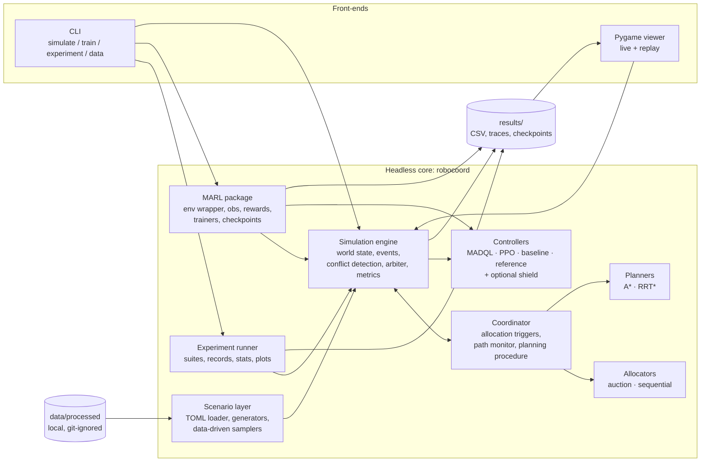

# 03 — System Architecture and Technical Decisions

| Field | Value |
|---|---|
| Document role | **Source of truth for architecture, technology stack, interfaces, repository layout and design decisions (ADRs).** |
| Status | Revision 2 (Issue #1, after design review; changes in `verification-log.md` V-1) |
| Depends on | `01-requirements.md` (what), `02-mathematical-model.md` (formal definitions and guarantees, §12) |

---

## 1. Architectural overview

The system is a **headless simulation core** surrounded by thin front-ends. Coordination follows a **three-level hierarchy** that mirrors the specification's three algorithm families:

| Level | Decision | Algorithm (selectable) | Frequency |
|---|---|---|---|
| Strategic | *Which robot does which task?* | Auction (Bertsekas ε-scaling), sequential auction baseline | Event-driven |
| Tactical | *Which reference route should the robot follow?* | A\*, RRT\* | Event-driven (path monitor) |
| Operational | *What does the robot actually do this step?* | MADQL, PPO (MAPPO/IPPO), rule-based baseline, reference follower (diagnostic) | Every step |

Below the operational level sit the **execution layers**: action mask, optional safety shield and arbiter (ADR-10). Guarantees are scoped per level:
- the strategic and tactical levels provide algorithmic guarantees *for their own sub-problems and snapshots*;
- the execution layers guarantee the physical invariants;
- **nothing guarantees end-to-end optimality or task completion** (model §5.5, §12).



Two dependency rules hold, enforced by the package layout and checked in review:
1. **Algorithms never import front-ends** (NFR-MAINT-2). The viewer only reads engine state or recorded traces.
2. **Algorithms do not depend on each other.** Planners do not know about RL; allocators do not know about planners. They depend only on `core` types and receive data through small query objects. The coordinator and the engine compose them.

---

## 2. Simulation step pipeline

One engine step performs the transition $\mathcal{T}$ of model §6 in this fixed order:

```mermaid
sequenceDiagram
    participant E as Engine
    participant W as World state
    participant C as Coordinator
    participant A as Allocator
    participant P as Planning procedure (A*/RRT*)
    participant K as Controller
    participant S as Shield (optional)
    Note over E: step t
    E->>W: 1. apply events due at t (task releases, map events with deferral)
    E->>W: 2. dynamic obstacles propose and resolve moves (fixed order) → z(t+1), hidden from controllers
    E->>C: 3. on_world_changed(events)
    C->>A: 3a. if allocation trigger: allocate(problem)
    A-->>C: assignment (goal changes → trigger T1)
    C->>P: 3b. robots with triggers T1–T6: plan(query) via shared constraints + two-stage procedure
    P-->>C: PlanResult (path | status, degraded, stats)
    E->>K: 4. observations + masks (incl. suggested action) → act()
    K-->>E: raw joint proposal a^ctrl
    E->>S: 5. shield (if enabled) → a^arb, interventions
    E->>W: 6. detect_conflicts(a^arb) → events; arbitrate → x(t+1); assert no physical collision
    E->>E: 7. detect_conflicts(a^ref) and (a^ctrl) for counterfactual metrics (no state change)
    E->>W: 8. pickups, deliveries, task status, rewards (base + shaping)
    E->>C: 9. path monitor: rejoin / deviation / stall bookkeeping
    E->>E: 10. metrics update, trace record
```

Design notes:
- **Obstacles move independently of robot actions at $t$.** At step 4 the controller sees $z_k(t)$ and velocities but not $z_k(t+1)$. Because $z(t+1)$ does not depend on the robots' actions, the counterfactual conflict sets in step 7 are exact (model §9.2).
- In the RL loop the controller is *outside* the engine. `MultiRobotEnv` (§5.6) runs steps 1–3, builds the observations and masks of step 4, returns them, receives the actions, and runs steps 5–10. Interactive and experiment loops call the controller themselves. Both share one engine code path.
- **Allocation triggers:** task released, task delivered, robot became idle, a plan status became `unreachable`, map event. Several triggers in one step cause a single auction.
- **Replanning triggers** T1–T6 (model §5.4) are evaluated in step 3b. At most one planner call per robot per step.

---

## 3. Technology stack

### 3.1 Selected stack

| Concern | Choice | Why this fits *this* project |
|---|---|---|
| Language | **Python 3.12–3.14** | Binding decision D-1. 3.12+ provides `tomllib`, modern typing and faster CPython. Supported versions are those passing the CI matrix (§3.3). Python 3.14-compatible releases of torch, numpy and pygame-ce were seen on PyPI on 2026-11-17; actual installation is verified in Issue #2. |
| Numerics | **NumPy** | Occupancy grids, distance fields, observation tensors, vectorised geometry, the brute-force neighbour index and the k-d tree build (`argpartition`). Seeded `numpy.random.Generator` streams. |
| Deep learning | **PyTorch (CPU)** | Small MLPs (~10⁵ parameters). Explicit training loops written by us, so the algorithms are not hidden in a library. CPU is sufficient (NFR-PERF-3). |
| Scientific utilities | **SciPy** | `linear_sum_assignment` (Hungarian) as an **independent oracle** for the auction. Statistical tests (Wilcoxon) and bootstrap utilities. SciPy's `cKDTree` is **not** used inside RRT\*; see §3.2. |
| Results handling | **pandas** | Aggregating per-run records in the experiment/analysis layer only. |
| Plots | **Matplotlib** | Static figures for the report. |
| Visualisation | **pygame-ce** | Real-time 2-D rendering, keyboard/mouse control, frame stepping, offline. The actively maintained community fork. |
| Configuration | **TOML via `tomllib`** + frozen `dataclasses` with explicit validation | Human-readable, no extra dependency. Errors name the offending field. |
| Testing | **pytest**, **Hypothesis**, **pytest-cov** | Property-based tests against independent oracles. |
| Quality | **ruff** (lint + format), **mypy** | NFR-MAINT-1. |
| Packaging | `pyproject.toml` (PEP 621), `src/` layout, `venv`, editable install; `requirements-lock.txt` | Standard and reproducible. |
| Kaggle access | Kaggle CLI/API (optional extra) or manual browser download | Downloads use the student's own account. Preprocessing is pure Python/pandas. |

### 3.2 Alternatives considered

| Decision | Alternative | Why not chosen |
|---|---|---|
| UI | Streamlit | Its rerun model is unsuited to smooth real-time animation and step control. |
| UI | Web front-end (FastAPI + JS canvas) | Two languages and a WebSocket protocol for no algorithmic benefit. Traces (ADR-7) keep this option open. |
| UI | Matplotlib animation | Slow redraws, weak interactivity. |
| RL framework | Stable-Baselines3 / RLlib | SB3 is single-agent. RLlib is heavy and hides the algorithms. |
| MA env API | PettingZoo dependency | We mirror its `ParallelEnv` method names but avoid a hard dependency for one environment. |
| RRT\* neighbour index | **Fixed-bucket spatial hash** | Rejected in revision 2. With a fixed bucket size in a bounded domain, bucket occupancy grows linearly with $n$, so queries cost $\Theta(n)$ and the earlier $O(\log n)$ claim did not hold (`04-algorithms.md` §3.2). |
| RRT\* neighbour index | SciPy `cKDTree` rebuilt per insertion | $O(n \log n)$ per insertion. Its split rule (maximum spread) also does not match the alternating-split assumption of the range-query bound we cite. We implement our own static alternating-median 2-d tree inside the Bentley–Saxe logarithmic method, plus a vectorised brute-force index as oracle and small-$n$ option. |
| Acceleration | Numba / Cython | Premature, and Cython conflicts with the Python-only intent. Profiling in Issues #3–#4 decides. |
| Config | YAML / Hydra | Extra dependencies; TOML is in the standard library. |

### 3.3 Continuous integration (decision 9)

`.github/workflows/tests.yml` (created in Issue #2) runs on every push and pull request:

| Job | Matrix | Steps |
|---|---|---|
| `quality` | ubuntu-latest × Python 3.14 | `ruff check .`, `ruff format --check .`, `mypy src/robocoord` |
| `tests` | ubuntu-latest × Python {3.12, 3.13, 3.14}; windows-latest × Python 3.14 | Install CPU-only PyTorch (CPU wheel index on Linux), `pip install -e ".[dev]"`, `pytest` (fast suite only) |

Slow, training and e2e tests run locally before an issue is closed (`05` §A.5), not in CI. CI results are recorded in the verification log by the student's report or a screenshot. Claude cannot see GitHub-hosted runs unless the student shares them.

---

## 4. Architecture Decision Records (ADRs)

Each ADR is written once. Later issues reference it rather than re-deciding.

### ADR-1: Discrete grid world with a continuous embedding

- **Decision.** The world is a 4-connected occupancy grid, and robots move one cell per step. The grid is embedded in $\mathbb{R}^2$ (cell = unit square) so that RRT\* plans in continuous space over the same map.
- **Consequences.**
  - A\* is exactly optimal on the lattice. RRT\* is faithful in continuous space.
  - Discretisation is an explicit, tested step.
  - Continuous and lattice feasibility coincide under the supercover rule (model Lemma 5.1).
  - Planner comparisons report both the lattice $\kappa$-cost and the continuous (weighted) length of both planners' outputs (`05` E1).

### ADR-2: Hierarchical integration of allocation, planning and learning

- **Decision.** The auction assigns tasks and the planner provides a reference path. The MARL policy chooses the primitive action each step from a local observation that includes the planner's suggested action, and may deviate from it.
- **Alternatives.**
  1. End-to-end RL: the planner would be decorative and long-horizon learning is sample-inefficient.
  2. RL selects planner or task: discards the allocation and planning guarantees.
  3. Planner only, RL as tie-breaker: RL's role would be too small to show cooperation.
- **Justification.** Each algorithm does what it is provably good at. RL learns decentralised, cooperative conflict avoidance under partial observability, which has no clean closed-form solution.
- **Consequences and limits (revision 2).**
  - Planner optimality and completeness are **snapshot properties of the reference path**. They do not transfer to executed trajectories or task completion (model §5.5, G15).
  - The path monitor is controller-agnostic and handles deviations (T3) and stalls (T4).
  - Adherence and counterfactual metrics (model §9.2–9.3) quantify how controllers use or improve on the reference.
  - The reference follower and the rule-based baseline are the natural ablations.

### ADR-3: MADQL variant

- **Decision.** **Parameter-shared independent Double DQN with team-mixed rewards and action masking**: one shared Q-network, a common replay buffer of per-robot transitions, Double-DQN targets and a target network.
- **Rationale.** The canonical multi-agent DQN form (Tampuu et al. 2017; Gupta et al. 2017). It is size-independent.
- **Known limits.** Non-stationarity; no convergence guarantee (G16).
- **Fallback.** VDN may be *added* if MADQL learns poorly in Issue #5. It never replaces this variant.

### ADR-4: PPO variant

- **Decision.** Shared stochastic actor. A centralised critic on $[o_i, \phi(s)]$ (MAPPO, Yu et al. 2022) or a local critic on $o_i$ (IPPO, de Witt et al. 2020), selected by a flag.
- **Rationale.** CTDE: execution needs only local observations.

### ADR-5: Auction allocator

- **Decision.** Bertsekas' forward auction with ε-scaling, implementing **weighted priority** (model §8.1). Baselines and references:
  - sequential single-item auction as the baseline;
  - SciPy Hungarian as test and experiment oracle only.
- **Rationale.** Genuinely market-based (prices, bids, equilibrium), with a provable optimality bound, defined complexity, and natural distributability.
- **Consequences (revision 2).**
  - The allocation is optimal *for the weighted objective* and guarantees maximum cardinality (G10).
  - It does **not** guarantee strict priority precedence (G11) or starvation freedom (G13). Aging is a mitigation, validated in E3.

### ADR-6: In-house multi-agent environment API

`MultiRobotEnv` provides:
- `reset(seed) -> (obs: dict[int, ndarray], info)`;
- `step(actions: dict[int, int]) -> (obs, rewards, terminated, truncated, info)`, i.e. PettingZoo-Parallel-style dictionaries with Gymnasium's termination/truncation semantics;
- `action_masks()` and `global_state()`.

`SyncVectorEnv` batches $E$ copies.

### ADR-7: Visualisation decoupled through traces

The engine emits a JSON-Lines trace per step (positions, events, conflict sets, assignments, paths, metrics). The Pygame viewer has a live mode and a replay mode.

### ADR-8: Determinism and seeding

- One master seed per run. Named child streams come from `numpy.random.SeedSequence(master).spawn` in a fixed order: `map`, `obstacles`, `tasks`, `planner`, `policy`, `torch`.
- Torch uses `torch.manual_seed`, `torch.use_deterministic_algorithms(True)` in tests, and one intra-op thread for timing runs.
- Scenario instances are identical across algorithm comparisons, which enables paired statistics.

### ADR-9: Data, results and model-artefact policy (revised per decisions 8 and 10)

- **Datasets.** Raw *and derived* Kaggle data are **not committed** by default. `data/raw/` and `data/processed/` are git-ignored.
  - Committed: acquisition and preprocessing code, dataset **manifests** (`data/manifests/*.json`: source, licence, download date, file hashes, row counts, filters, parameters), attribution, and small **synthetic** test fixtures (`tests/fixtures/data/`) in each dataset's schema.
  - Redistribution of any derived data is considered only after verifying the dataset's licence and terms, and with the student's explicit approval.
- **Results.** Runs, traces, figures and test reports go to `results/` (git-ignored). Curated summaries are recorded in the documentation.
- **Model checkpoints.** Final trained policies may be committed to `models/` if each file is **< 5 MB** and contains **inference-only weights** (actor or Q-network `state_dict`; no optimiser state, replay buffer or critic unless needed for evaluation). Each checkpoint has a JSON sidecar with:
  - algorithm and variant;
  - model, observation and reward specification versions;
  - training config hash and full config;
  - seeds;
  - environment steps;
  - validation score;
  - experiment ID and code version.

  Training checkpoints with optimiser state stay in `results/`.

### ADR-10: Execution layers and safety semantics (new in revision 2)

- **Decision.** Every controller's action passes through three layers:
  1. an **always-on action mask** (static feasibility only);
  2. an **optional predictive shield** (`shield = "off" | "predictive"`; off in training and in main experiments, evaluated as an ablation);
  3. the **always-on arbiter**, which cancels conflicting moves (emergency stop).
- **Rationale.**
  - Masking only static infeasibility leaves dynamic-safety decisions to the policy, which is what RL should learn.
  - The arbiter guarantees physical invariants for any controller (G1), so learned policies can never corrupt the simulation.
  - The shield shows what a simple rule-based safety layer adds.
- **Consequences.**
  - Safety is measured by **proposed conflicts** and the counterfactual avoided/introduced sets, not by physical collisions, which are 0 by construction and serve as an invariant check (model §9.2).
  - Conflict events are recorded as sets keyed by (step, type, entities).

---

## 5. Components and interfaces

The signatures below are the *planned contracts*. Names may be refined in the implementing issue, but responsibilities are fixed here.

### 5.1 `core`: shared types and grid primitives (Issue #2)

```python
Cell = tuple[int, int]
class Action(IntEnum): STAY=0; UP=1; DOWN=2; LEFT=3; RIGHT=4
class OccupancyGrid:            # static occupancy; set_blocked() bumps .version
    def is_free(self, c: Cell) -> bool: ...
    def neighbors(self, c: Cell) -> Iterator[Cell]: ...
def bfs_distance_field(grid: OccupancyGrid, target: Cell) -> np.ndarray   # int32, -1 unreachable
class DistanceOracle:           # LRU cache keyed by (target, grid.version); capped distance helper
    def distance(self, a: Cell, b: Cell) -> int | None: ...
def load_movingai_map(path) -> OccupancyGrid; def save_movingai_map(grid, path) -> None
```

### 5.2 `world` and `scenario` (Issue #2)

- Entities and the task state machine; illegal transitions raise `InvalidTransitionError`.
- Task *availability* (model §4).
- `MotionModel.propose(...)`; `ArrivalProcess.releases(t, rng)`.
- Map events with the deferral rule.
- `ScenarioSpec`: loaded from TOML, validated, plus synthetic generators.

### 5.3 `sim`: engine, conflicts, metrics, traces (Issue #2)

```python
def detect_conflicts(state: WorldView, proposal: Mapping[int, Action], obs_next) -> frozenset[ConflictEvent]
def arbitrate(state: WorldView, proposal, events) -> Resolution     # positions, frozen, blocked
class Engine:
    def reset(self) -> WorldView
    def prepare_step(self) -> WorldView                               # pipeline steps 1–3
    def apply_actions(self, actions: Mapping[int, Action]) -> StepOutcome   # steps 5–10
class MetricsRecorder: ...       # model §9, including event-set counterfactuals
class TraceWriter: ...
```

`ConflictEvent` is a frozen dataclass `(t, kind, entities)`. `WorldView` is read-only.

### 5.4 `planning`: constraints, procedure, A\*, RRT\*, monitor (Issue #3)

```python
@dataclass(frozen=True)
class PlanConstraints:            # built ONCE per query by build_constraints(); shared by A* and RRT*
    static: OccupancyGrid
    dynamic_blocked: frozenset[Cell]      # B_i: (Z_i ∪ Ẑ_i) minus start and goal
    proximity: frozenset[Cell]            # Q_i (empty if nothing sensed)
    lambda_prox: float

@dataclass(frozen=True)
class PlanQuery:  start: Cell; goal: Cell; constraints: PlanConstraints; rng: np.random.Generator
@dataclass(frozen=True)
class PlanResult:
    path: tuple[Cell, ...] | None
    cost: float
    status: Literal["ok", "unreachable", "budget_exhausted", "invalid_query"]
    degraded: bool                        # True if produced by the static fallback stage
    stats: PlanStats                      # expansions / iterations, k, k', propagation work, time_s, trigger

class Planner(Protocol):
    name: str
    def plan(self, query: PlanQuery) -> PlanResult: ...
def plan_with_procedure(planner: Planner, query: PlanQuery) -> PlanResult   # model §5.3, identical for all planners

class NeighborIndex(Protocol):            # RRT* only
    def insert(self, p: np.ndarray) -> int: ...
    def nearest(self, q: np.ndarray) -> int: ...
    def radius(self, q: np.ndarray, r: float) -> np.ndarray: ...
class PathMonitor: ...                    # triggers T1–T6, rejoin, stall block list
```

### 5.5 `allocation` (Issue #4)

```python
@dataclass(frozen=True)
class AllocationProblem: robots: Sequence[int]; tasks: Sequence[int]; benefit: np.ndarray  # -inf = infeasible
class Allocator(Protocol):
    name: str
    def allocate(self, problem: AllocationProblem) -> AllocationResult
def build_benefits(world: WorldView, oracle: DistanceOracle, cfg: BenefitConfig) -> AllocationProblem
```

### 5.6 `control` and `marl` (Issues #4–#6)

```python
class Controller(Protocol):
    name: str
    def reset(self, n_robots: int) -> None: ...
    def act(self, view: WorldView, obs: Mapping[int, Observation]) -> dict[int, Action]: ...
class Shield: def apply(self, view, proposal) -> tuple[dict[int, Action], list[ShieldEvent]]
```

- `control.reference.ReferenceFollower`, `control.baseline.BaselineController`, `control.shield.Shield` (Issue #4).
- `marl.env.MultiRobotEnv`, `observation`, `reward` (base + potential, model §7), `global_state`, `vector_env`.
- `marl.madql`, `marl.ppo`, `networks`, `replay`, `rollout`, `trainer`, `checkpoint`.
- `marl.policy.LearnedController`.

### 5.7 `experiments` (Issues #3, #4, #6, #8)

- `ExperimentSpec` (TOML): factors, seed lists, budget caps, metrics.
- Resumable runner writing one `RunRecord` per run, including event-set summaries.
- `stats`: bootstrap CIs, paired bootstrap of differences, Wilcoxon, Holm, effect sizes.
- `plots`.

### 5.8 `viz` and `cli` (Issue #8; CLI grows from Issue #2)

- `python -m robocoord simulate --scenario ... --planner astar|rrtstar --allocator auction|sequential --controller baseline|reference|madql|ppo [--checkpoint ...] [--shield off|predictive] [--trace out.jsonl] [--headless]`
- `python -m robocoord train --config ... --seed 1`
- `python -m robocoord experiment --config ...`
- `python -m robocoord data prepare <dataset>`
- `python -m robocoord view --trace ...` or `view --scenario ...`

The viewer highlights proposed conflicts, shield interventions and deviations from the reference path.

---

## 6. Algorithm selection mechanism

```python
PLANNERS:    {"astar": AStarPlanner, "rrtstar": RRTStarPlanner}
ALLOCATORS:  {"auction": AuctionAllocator, "sequential": SequentialAuctionAllocator}
CONTROLLERS: {"baseline": BaselineController, "reference": ReferenceFollower,
              "madql": LearnedController.from_madql, "ppo": LearnedController.from_ppo}
```

Each factory takes its typed config section (e.g. `[planner.rrtstar] max_iterations = 2000`, `neighbor_index = "kdtree"`). The same names are used by the CLI, viewer and experiment specs. Unknown names fail at load time with the valid choices listed.

---

## 7. Training and evaluation organisation

**Training** (`marl/trainer.py`):
1. Load `TrainingConfig`.
2. Build $E$ environments with distinct derived seeds from the **training seed range**.
3. Run the algorithm loop.
4. Validate periodically on the fixed **validation seed set**.
5. Checkpoint (ADR-9).

The shield is **off** during training, so policies receive the conflict signal directly.

**Curriculum** (configurable, advanced by fixed step counts):
1. static obstacles, 2–4 robots;
2. dynamic obstacles added;
3. arrivals and map events, 4–8 robots.

**Planner inside training.** The default is A\* (deterministic, cheap). Training with RRT\* inside the environment happens if the budget allows (decided in Issue #6). Otherwise A\*-trained policies are evaluated **cross-planner** with RRT\* guidance. This is valid because the observation's suggested-action interface and the shaping potential are planner-agnostic. The choice is reported explicitly.

**Evaluation** uses held-out test seeds and, from Issue #7, data-driven scenario families (out-of-distribution test).

---

## 8. Scalability and performance design

| Concern | Design measure |
|---|---|
| Observation size vs team size | Egocentric window plus pooled global summary: $O(1)$ in $N$ and map size |
| Conflict detection and arbitration | Hash maps and a worklist: $O(N+K)$ expected per step, including the counterfactual detection |
| Distance queries | BFS fields cached per target and invalidated by `grid.version` |
| Planner calls | Only on triggers T1–T6, at most one per robot per step, with cooldowns |
| RRT\* neighbourhoods | Bentley–Saxe logarithmic method over alternating-median 2-d trees, or a vectorised brute-force index. Bounds in `04` §3.6 (no $O(n\log n)$ claim). |
| Policy inference | One batched forward pass per step |
| Training throughput | Synchronous vectorised environments; a process-based vector env is an optional extension |

---

## 9. Error handling and validation

- `ConfigError` and `ScenarioError` at load time, naming the field.
- Planners never raise for "no path". They return a status, and invalid queries return `invalid_query`.
- The engine asserts **no physical collision** after every step, always (not only in debug). A violation aborts the run with a full state dump, since it is a simulator defect (G1). The task-state-machine and mask checks are debug-mode assertions.
- The auction validates benefit-matrix shape and value range.
- RL code stops on NaN or Inf losses with a diagnostic.

---

## 10. Repository layout

Directories are created **in the issue that first needs them**, never empty in advance. The Issue #1 commit contains only `docs/`, `.gitignore` and the unchanged `README.md`.

```text
.
├── README.md                     # final version written in Issue #8
├── pyproject.toml                # Issue #2
├── requirements-lock.txt         # Issue #2
├── .gitignore
├── .github/workflows/tests.yml   # Issue #2 (CI, §3.3)
├── docs/                         # README.md (index), 01–07, verification-log.md
├── configs/  scenarios/ (#2+) · experiments/ (#3+) · training/ (#5+)
├── src/robocoord/
│   ├── __init__.py, __main__.py, cli.py
│   ├── core/          types.py, grid.py, distance.py, mapio.py, rng.py                 (#2)
│   ├── world/         entities.py, motion.py, arrivals.py, events.py                    (#2)
│   ├── scenario/      spec.py, loader.py, generators.py                                 (#2; samplers #7)
│   ├── sim/           engine.py, conflicts.py, coordinator.py, metrics.py,
│   │                  trace.py, text_render.py                                           (#2–#4)
│   ├── planning/      base.py, constraints.py, procedure.py, astar.py, rrtstar.py,
│   │                  geometry.py, kdtree.py, neighbors.py, monitor.py                   (#3)
│   ├── allocation/    base.py, benefits.py, auction.py, sequential.py                   (#4)
│   ├── control/       base.py, reference.py, baseline.py, shield.py                     (#4)
│   ├── marl/          env.py, observation.py, reward.py, global_state.py, vector_env.py,
│   │                  networks.py, replay.py, rollout.py, madql.py, ppo.py,
│   │                  trainer.py, policy.py, checkpoint.py                               (#5–#6)
│   ├── data/          olist.py, nyc_taxi.py, mazes.py, trajectories.py, mapping.py      (#7)
│   ├── experiments/   spec.py, runner.py, records.py, stats.py, plots.py                (#3+)
│   └── viz/           app.py, drawing.py, hud.py                                        (#8)
├── tests/  conftest.py · unit/ (mirrors src) · integration/ · e2e/ · fixtures/data/ (#7, synthetic)
├── data/   manifests/ (#7, committed) · raw/ and processed/ (git-ignored)
├── models/                       # #6/#8: committed inference-only checkpoints < 5 MB + JSON sidecars
└── results/                      # git-ignored: runs, traces, training checkpoints, figures, test reports
```

Package name: **`robocoord`**.

---

## 11. Coding conventions

- PEP 8 via `ruff format`; line length 100.
- Full type hints. `mypy --strict` on `core`, `planning`, `allocation`.
- Google-style docstrings that state complexity with its type (worst, expected, amortised), e.g. `Time: O(V log V) worst case`.
- Frozen, slotted dataclasses for queries, results, events and specs. Mutable state is confined to the engine, the world, the agents and the indexes.
- No global state and no hidden randomness: every sampling function takes a `Generator`.
- Units: cells and steps.
- Python only. No compiled extensions of our own.
