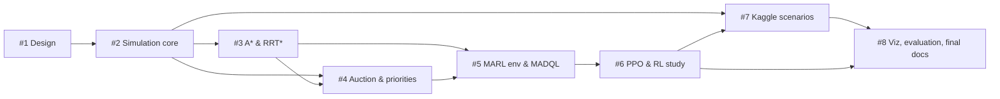

# 07 — Development Plan, GitHub Workflow and Issue Definitions

| Field | Value |
|---|---|
| Document role | **Source of truth for the work plan**: the 8 issues (scope, tasks, tests, acceptance criteria), their order and dependencies, the GitHub workflow, the resolved approval decisions, and risks. |
| Status | Revision 2, **approved by the student on 2026-11-17**. Decisions resolved in §5. |

---

## 1. GitHub workflow

The student performs **all** repository operations in GitHub Desktop and on GitHub.com. Claude edits files in the local working tree, runs tests and reports results, and states exactly what to do at each GitHub step. Claude never runs Git or GitHub commands.

**Branches**

| Branch | Purpose |
|---|---|
| `main` | Stable, reviewed checkpoints only (merged from `develop` at the points in §3) |
| `develop` | Integration branch; every issue branch starts from and merges back into it |
| `<type>/<short-name>` | One branch per issue, created from `develop` (names in §4) |

**Per-issue cycle**

1. **GitHub.com:** create the issue. Copy the title and body from §4: at minimum Objective, Scope, Acceptance criteria and Testing.
2. **GitHub Desktop:** set *Current Branch* to `develop`, then *Fetch origin* / *Pull origin*.
3. **GitHub Desktop:** *Branch → New Branch…*, enter the name from §4, and base it on `develop`.
4. **Claude:** reviews the issue scope, implements, writes and runs tests, updates docs and the verification log, and reports results.
5. **Claude:** provides commit message(s). Large issues may be committed at 2–4 logical checkpoints.
6. **GitHub Desktop:** review the changed files, enter the summary and description, *Commit to <branch>*, then *Push origin* (first time: *Publish branch*).
7. **GitHub.com:** open a pull request with base `develop` ← compare `<branch>`. Body: `Closes #<n>` plus the test summary. From Issue #2 on, wait for the CI checks (§3.3 of `03`) to pass, review, then merge.
8. **GitHub Desktop:** switch to `develop` and *Pull origin*.
9. **Checkpoints (§3):** open and merge a pull request `main` ← `develop` on GitHub.com.

**Commit convention.** Conventional Commits: `type(scope): imperative summary`.
- Types: `feat`, `fix`, `test`, `docs`, `refactor`, `build`, `ci`, `exp` (experiment configs and results summaries).
- Scopes: `sim`, `planning`, `allocation`, `control`, `marl`, `data`, `viz`, `experiments`, `docs`.

No milestones are used.

---

## 2. Issue overview and dependencies

| # | Title | Branch | Depends on |
|---|---|---|---|
| 1 | Project design and technical documentation | `docs/project-design` | — |
| 2 | Simulation core, scenario system and project tooling | `feature/simulation-core` | #1 |
| 3 | Online path planning: A\* and RRT\* with dynamic replanning | `feature/path-planning` | #2 |
| 4 | Market-based task allocation, priority handling and baseline coordination | `feature/task-allocation` | #2, #3 |
| 5 | Multi-agent RL environment and MADQL | `feature/marl-madql` | #3, #4 |
| 6 | PPO (MAPPO/IPPO) and comparative learning study | `feature/marl-ppo` | #5 |
| 7 | Kaggle dataset integration and data-driven scenarios | `feature/kaggle-scenarios` | #2 (pipeline), #6 (for E7) |
| 8 | Interactive visualisation, full evaluation and final documentation | `feature/visualisation-evaluation` | all |

---

## 3. Stable checkpoints (`develop` → `main`)

| After | State of `main` |
|---|---|
| #1 | Approved design (revision 2) |
| #4 | Complete **non-learning** system: simulation, A\*/RRT\*, auction, reference follower, baseline, shield; experiments E1–E3 |
| #6 | Both MARL algorithms implemented, trained and compared (E4, development comparison) |
| #8 | Final project: data-driven scenarios, visualisation, full evaluation, final README |

---

## 4. Issue definitions

### Issue #1 — Project design and technical documentation

**Branch** `docs/project-design` · **Labels** `documentation`

- **Objective.** Establish requirements, mathematical model, architecture, algorithm design, test and evaluation methodology, data plan and work plan before any application code.
- **Scope.** In: `docs/` (8 documents + index), `.gitignore`. Out: application code, tooling files, final README.
- **Deliverables.** `docs/README.md`, `01`–`07`, `verification-log.md`, `.gitignore`.
- **Testing requirements.** No code, so no automated tests. A manual cross-document consistency review is recorded in `verification-log.md` (V-0, V-1).
- **Acceptance criteria.**
  1. The student approves revision 2, including the seven technical corrections and the decision table (§5).
  2. All required algorithms (A\*, RRT\*, MADQL, PPO, auction) appear consistently in requirements, model, algorithms and plan.
  3. Every guarantee is listed in model §12 with its status.
  4. Each of issues #2–#8 has objective, scope, tasks, tests and acceptance criteria.
- **Commit message.** `docs: add requirements, mathematical model, architecture and development plan`

---

### Issue #2 — Simulation core, scenario system and project tooling

**Branch** `feature/simulation-core` · **Labels** `enhancement`, `simulation`

- **Objective.** Build the deterministic, headless simulation that all algorithms plug into (world, dynamics, tasks, conflict detection, arbitration, metrics, traces, scenarios), together with the project tooling and CI.
- **Scope.**
  - *In:*
    - `pyproject.toml` (`requires-python = ">=3.12,<3.15"`, dependencies, ruff, mypy, pytest markers), `requirements-lock.txt`.
    - `.github/workflows/tests.yml` (CI matrix of `03` §3.3).
    - `core` (grid, MovingAI I/O, BFS fields, capped distances, `DistanceOracle`, seeding).
    - `world` (entities, task state machine and availability, motion models, arrivals, map events with deferral).
    - `scenario` (TOML spec, validation, generators: random density, rooms, warehouse aisles).
    - `sim`:
      - `conflicts.detect_conflicts` and `arbitrate` (model §3; `04` §1);
      - the engine pipeline with pluggable coordinator and controller protocols;
      - `MetricsRecorder` with conflict event sets and the counterfactual infrastructure, fed by stub suggested actions until #3;
      - JSON-Lines traces and a text renderer.
    - CLI `simulate --controller scripted`; example scenarios.
  - *Out:* planners, allocators, baseline, reference and learned controllers. Tests use scripted proposals and stub coordinators.
- **Prerequisites.** #1 approved.
- **Implementation plan.**
  1. Tooling and CI workflow. Create the venv and editable install, and confirm `pytest`, `ruff` and `mypy` run on Python 3.14 locally.
  2. `core` with tests (BFS vs Floyd–Warshall, map I/O round-trip).
  3. Entities, task state machine and availability with tests.
  4. Motion models, arrivals and map-event deferral with seeded tests.
  5. Scenario spec, validation and generators (X-3).
  6. `detect_conflicts` and `arbitrate`: hand cases plus the property test against a naive oracle (≥ 500 cases), and the physical-collision invariant.
  7. Engine pipeline, metrics (conflict sets, blocked moves) and traces (X-1, X-2, X-6 conflict part).
  8. CLI and e2e smoke test.
- **Technical decisions.** ADR-1, ADR-6, ADR-7, ADR-8, ADR-10 (arbiter part). Worklist arbitration in $O(N+K)$. Conflict events keyed by (step, type, entities).
- **Deliverables.** Packages `core`, `world`, `scenario`, `sim`; `configs/scenarios/*.toml`; tests; CI workflow.
- **Testing requirements.** Listed above, in particular the arbiter and detector property tests, determinism (X-1), invariants (X-2), scenario validation (X-3), and conflict-metric correctness (X-6).
- **Acceptance criteria.**
  1. The editable install works locally on Python 3.14 (Windows). The CI workflow runs the quality job and the test matrix (3.12/3.13/3.14 Linux, 3.14 Windows), and the student confirms CI passes on the pull request. A version not passing CI is removed from `requires-python` and the docs.
  2. Arbitration produces no physical collision on any generated case, and conflict sets equal the naive oracle's.
  3. Same seed gives an identical trace. A different seed gives a different stochastic evolution.
  4. Conflict-event metrics, blocked moves and task metrics not requiring planners are computed and tested.
  5. Gates pass; coverage targets met for `core` and `sim`.
- **Documentation.** Implementation notes for `04` §1 and §2.1; scenario-format appendix in `03`; verification-log entry.
- **Commit messages.**
  - `build: add project packaging, tooling and CI workflow`
  - `feat(sim): add grid, entities, dynamics and scenario system`
  - `feat(sim): add conflict detection, arbitration, engine, metrics and traces`

---

### Issue #3 — Online path planning: A\* and RRT\* with dynamic replanning

**Branch** `feature/path-planning` · **Labels** `enhancement`, `algorithms`

- **Objective.** Implement both required planners behind one interface, with identical dynamic-obstacle and goal policies and reactive replanning, and measure them (E1, E2), including an honest RRT\* complexity evaluation.
- **Scope.**
  - *In:*
    - `planning.base`, `constraints` (shared $B_i$, $Q_i$, $\omega_i$; model §5.2) and `procedure` (two-stage planning, status and `degraded` mapping; model §5.3).
    - `astar`.
    - `geometry` (supercover, weighted segment cost, discretisation).
    - `neighbors.BruteForceIndex` and `kdtree` (static alternating-median 2-d tree + Bentley–Saxe `LogKDTreeIndex`).
    - `rrtstar` (eager cost propagation, work counters, convergence trace).
    - `monitor` (triggers T1–T6, rejoin, stall block list, trigger attribution).
    - Coordinator integration: goals come from fixtures until #4, and robots follow suggested actions via a test-only scripted follower.
    - Minimal experiment runner; E1 and E2 configurations and runs.
  - *Out:* task allocation, the baseline, reference and learned controllers (#4+).
- **Prerequisites.** #2.
- **Implementation plan.**
  1. Interfaces, registry, constraint builder, procedure, with tests (empty sensed set, goal and start exemption, fallback, static unreachability).
  2. A\* with oracle property tests (≥ 1 000 instances).
  3. Geometry with dense-sampling and integration tests.
  4. Neighbour indexes: k-d tree invariants, Bentley–Saxe slot invariants, and equivalence with brute force (property test).
  5. RRT\* with validity, monotonicity, tree-cost-invariant and determinism tests.
  6. X-11 planner policy consistency.
  7. Path monitor and engine integration (X-5 planning part, X-12).
  8. Experiment runner (spec, records, resumability, environment info, timeouts).
  9. Run E1 (E1a/b/c) and E2. Compare measured counters and exponents with the *named* bounds of `04` §2.3 and §3.6. Choose the default neighbour index from E1b and record the choice.
- **Technical decisions.** `04` §2–3. $\gamma_f = 1.5$. No $O(n\log n)$ claim for RRT\*.
- **Deliverables.** `planning/*`; `experiments/{spec,runner,records,stats}.py`; `configs/experiments/e1_*.toml`, `e2_replanning.toml`; tests; E1/E2 results.
- **Testing requirements.** All of `04` §2–3, plus X-5 (planning), X-11, X-12 (monitor), and X-1 for both planners.
- **Acceptance criteria.**
  1. A\* equals the BFS/Dijkstra oracle on ≥ 1 000 random instances.
  2. RRT\* paths are always valid for the snapshot. Best cost is monotone. The tree-cost invariant holds. Results are deterministic per seed. The k-d index agrees with brute force on all generated cases.
  3. X-11: A\* and RRT\* return identical statuses and `degraded` flags on ≥ 300 random queries.
  4. Both planners are selectable by name. Replanning triggers fire as specified and are attributed.
  5. E1 and E2 are recorded, and the measured work counters ($k$, $k'$, NN-visited nodes, $s$) and exponents are compared with the unconditional and conditional bounds. Whether assumptions U and R held is stated.
- **Documentation.** `04` §2–3 implementation notes (default index, measured behaviour, deviations); E1/E2 in the results register; verification log.
- **Commit messages.**
  - `feat(planning): add shared planning constraints, procedure and A*`
  - `feat(planning): implement RRT* with k-d tree neighbour index and path discretisation`
  - `feat(planning): add path monitor and reactive replanning`
  - `exp(planning): add planner experiments E1-E2 and results`

---

### Issue #4 — Market-based task allocation, priority handling and baseline coordination

**Branch** `feature/task-allocation` · **Labels** `enhancement`, `algorithms`

- **Objective.** Implement the auction allocator with weighted priority, aging (as mitigation), pre-emption and hysteresis. Add the non-learning controllers and the shield. Together these give the first complete multi-robot system, measured by E3.
- **Scope.**
  - *In:*
    - `allocation.benefits` (offset $M$, integer scaling, padding with infeasible-as-zero, availability), `auction` (ε-scaling and fixed-ε modes), `sequential`.
    - Allocation triggers and policy in the coordinator.
    - `control.reference` (reference follower), `control.baseline` (right-of-way), `control.shield`.
    - Counterfactual conflict metrics now using real suggested actions (X-10).
    - End-to-end `simulate` for every planner × allocator × {reference, baseline} × shield setting.
    - E3a/E3b; Issue #4 non-learned system-comparison numbers.
  - *Out:* learned controllers, visualisation.
- **Prerequisites.** #2, #3.
- **Implementation plan.**
  1. Benefits with tests (offset and cardinality, padding equivalence, infeasible pairs, rounding bound).
  2. Auction with the Hungarian-oracle property test, the ε-CS check and the $k\varepsilon$ bound test.
  3. Sequential auction with the ½-approximation test and a counter-example.
  4. Weighted-priority tests (`04` §4.4: threshold, hysteresis, aging properties P1–P3).
  5. Coordinator allocation policy: triggers, availability, pre-emption, release on `unreachable`.
  6. Reference follower, baseline and shield, with unit tests, X-10, and the corridor case resolved via T4.
  7. Scenario tests: X-5 (allocation part) and X-6 (task metrics incl. per-level waiting tails).
  8. E3a and E3b with paired statistics; measure NFR-PERF-1.
- **Technical decisions.** ADR-5, ADR-10; `04` §4–5; defaults $\kappa, h, \alpha, s$ from model §11.
- **Deliverables.** `allocation/*`, `control/*`, coordinator changes, tests, `configs/experiments/e3_*.toml`, E3 results, end-to-end demo scenarios (text renderer).
- **Testing requirements.** `04` §4–5, plus X-5, X-6, X-10, and X-1 for all non-learning combinations with shield on and off.
- **Acceptance criteria.**
  1. The auction equals the Hungarian optimum on all generated integer instances with maximum cardinality. Fixed-ε results are within $k\varepsilon$.
  2. The weighted-priority threshold test passes on both sides of the threshold. Hysteresis and P1–P3 tests pass. No test asserts strict precedence or starvation freedom.
  3. **Priority-sensitivity validation (E3b):** the paired comparison κ > 0 vs κ = 0 of $F_w$ and top-level flow time is reported with CIs and effect sizes, together with the travel-cost price. The α > 0 vs α = 0 comparison of lowest-level waiting tails is reported likewise. If κ > 0 does not improve the priority-sensitive metrics, the benefit design is reviewed with the student before the issue is closed, and the finding is documented.
  4. Static and dynamic demo scenarios run end-to-end with every planner × allocator × {reference, baseline}. The baseline delivers every task that stays available in the designated demo scenarios (AC-6).
  5. E3a is recorded with measured exponents vs the cited bound. NFR-PERF-1 is measured and reported, met or not.
- **Documentation.** `04` §4–5 implementation notes; E3 results; verification log. **Checkpoint merge to `main`.**
- **Commit messages.**
  - `feat(allocation): implement auction-based allocation with weighted priority and aging`
  - `feat(allocation): add sequential auction baseline and allocation triggers`
  - `feat(control): add reference follower, priority-aware baseline and safety shield`
  - `exp(allocation): add allocation experiments E3 and results`
- **Scope reconciliation and outcome (Project Issue #4, 2026-11-18).**
  - **Numbering.** This plan's *Project Issue #4* (this section) is tracked on GitHub as **GitHub issue #8**. This plan's own *Issue #8* (interactive visualisation, full evaluation, final documentation; below) is a different issue, and it is the one `05` §B.4 means when it assigns E5 and E6 to "#8". Elsewhere in this document "Issue #n" means the plan's numbering.
  - *Scope history.* A temporary narrow scope excluded the reference follower, the shield and X-10. The student's final authorization restored the full scope above and added a **deadlock-detour mechanism (stage 5B)**, which was not in the original plan. Nothing above is deleted. The table records what was delivered against each item.

  | Item | Delivered | Evidence |
  |---|---|---|
  | `allocation.benefits`, `auction` (ε-scaling, fixed ε), `sequential` | yes | `04` §4.1–4.2 notes; Hungarian-oracle property tests; E3a |
  | Triggers and coordinator policy (pre-emption, hysteresis, release) | yes, plus the keep-current tie-break | `04` §4.3 notes |
  | `control.reference` | yes (action-identical to the Issue #3 follower) | `04` §5.3; X-10 tests |
  | `control.baseline` (right-of-way) | yes | `04` §5.3; collision property G19 |
  | `control.shield` | yes | `04` §5.4; G23 |
  | X-10 with real suggested actions | yes (categories in model §9.2) | `tests/integration/test_shield_x10_integration.py` |
  | Deadlock detour (new, stage 5B) | yes, opt-in, default on for the baseline | `04` §5.5; G21, G22 |
  | End-to-end `simulate`, every planner × allocator × controller × shield | yes, 16 combinations | `tests/integration/test_cli_matrix.py` |
  | E3a / E3b with paired statistics | yes | `05` §B.6 E3 |
  | Issue #4 non-learned system comparison (stored as `e5_*`) | yes: **both non-learned controllers**, baseline and reference follower. Planner × allocator × dynamics × 50 test seeds per controller = 1 200 paired episodes without endpoint recovery; the same instances with endpoint recovery add 1 200 more (2 400 runs in total, `05` §B.6). The baseline half was run first; the reference half was added after the audit. Learned controllers and the shield ablation remain for the plan's Issues #5/#6 (development comparisons), and E5/E6 for Issue #8. **Not E5.** | `05` §B.6 |
  | NFR-PERF-1 measured (an **A\*** requirement) | yes. **Before** optimisation: not met as a per-step bound (21–29 of ≈ 2 800 steps per run ≥ 20 ms, all first or map-event steps). **After** the follow-up optimisation (O1 flat BFS, O2 component reachability, symmetric field reuse; exact): **met as a strict per-step maximum for workload R on AC power on this machine**, in the original benchmark (max 9.53 ms over 4 401 steps) and in an independent Windows verification (`results/perf_verify/`, max 10.56 ms). Every A\* configuration of the full workload stays below 20 ms (max 15.43 ms). RRT\* is outside NFR-PERF-1; its steps still exceed 20 ms in 23–34 % of workload F, reported as a limitation. An intermediate run on battery power exceeded on 3 of 40 first steps; the final code was not measured on battery. | `05` §B.6 NFR-PERF-1 |
  | Endpoint recovery (follow-up, approved after the audit) | yes: idle-robot parking and retreat from a persistently held goal, on by default with an allocator for both controllers (`--endpoint off` restores the earlier behaviour). Issue #4 system comparison, baseline: 91 → 8 undelivered tasks, 83 → 8 incomplete episodes, 0 regressions; reference: 1 357 → 1 286. The remaining endpoint cases are reported (`attempts_exhausted`, `unresolved_*_at_end`). No delivery guarantee (G26). | `04` §5.6; `05` §B.6; G25–G27 |
  | Scenario tests X-5 (allocation part) and X-6 | covered by the allocation and CLI integration tests | `tests/integration/test_allocation_integration.py`, `test_cli_matrix.py` |

  - *Acceptance criteria.*
    - Criteria 1–3 and 5 are met with the evidence above.
    - Criterion 4 is met for {reference, baseline} × both planners × both allocators × shield on/off on the static (`headon_two_lane`) and dynamic (`demo_delivery`, `random_warehouse`, `preemption`) demos.
    - The AC-6 delivery part holds for the baseline on these designated demos (with endpoint recovery on, the default, and off; `test_cli_matrix.py`). Its stated assumption: tasks that stay available. Endpoint recovery now parks idle robots off active endpoints, but it does not guarantee delivery in general (G26).
  - *Demo scenarios added:* `headon_two_lane` (detour resolves), `headon_single_lane` (reported unresolved), `preemption` (urgent-task pre-emption), `shield_corridor` (shield interventions; not a delivery demo).

---

### Issue #5 — Multi-agent RL environment and MADQL

**Branch** `feature/marl-madql` · **Labels** `enhancement`, `reinforcement-learning`

- **Objective.** Wrap the simulator as a multi-agent RL environment, build the training infrastructure, and implement and train MADQL (*parameter-shared independent Double DQN with team-mixed rewards and action masking*).
- **Scope.**
  - *In:* `marl.env`, `observation`, `reward` (base reward + phase-aware potential shaping + team mixing; model §7), `global_state`, `vector_env`, `networks`, `replay`, `madql`, `trainer`, `checkpoint`, `policy`; CLI `train`; curriculum configs; MADQL training (≥ 3 seeds); development comparison vs reference follower and baseline on validation block B (seeds 10 020–10 099).
  - *Out:* PPO and the final comparison.
- **Prerequisites.** #3, #4.
- **Implementation plan.**
  1. Observation builder and reward with tests (`04` §8, X-13).
  2. Env API, termination vs truncation, vector env (shape, determinism and auto-reset tests).
  3. Networks, replay and MADQL update (`04` §6 tests 1–5).
  4. Trainer (logging, validation on the validation seed set, checkpoints; X-7, e2e smoke test).
  5. Sanity runs, then full training (≥ 3 seeds, fixed step budget).
  6. Development comparison on validation block B (seeds 10 020–10 099) with paired statistics. Test seeds are not used: E5 and E6 are Issue #8.
- **Technical decisions.** ADR-3, ADR-6, ADR-10 (shield off in training); model §6–7; replay layout < 300 MB.
- **Deliverables.** `marl/*` (minus PPO), `configs/training/madql*.toml`, tests, learning curves, E4 (MADQL part).
- **Testing requirements.** `04` §6 and §8, X-7, X-13, e2e `train`, X-1 with a learned controller.
- **Acceptance criteria.**
  1. All MADQL L1/L2 tests pass, including chain-MDP learning sanity, and X-13 (shaping telescopes; zero potential at termination).
  2. Training is reproducible from config + seed. Checkpoints round-trip.
  3. ≥ 3 seeds trained. Curves, validation metrics and paired held-out development comparisons (validation block B) vs the reference follower and baseline are reported, whatever their outcome.
  4. A trained MADQL policy runs as a selectable controller with both planners, with the shield on or off.
- **Documentation.** `04` §6 and §8 notes with final hyper-parameters; E4 (MADQL); verification log.
- **Commit messages.**
  - `feat(marl): add multi-agent environment, observations and shaped rewards`
  - `feat(marl): implement MADQL with replay and Double DQN targets`
  - `feat(marl): add training pipeline, checkpoints and learned controller`
  - `exp(marl): add MADQL training results`
- **Outcome (Issue #5, 2026-11-19).** What was delivered against each item:

  | Item | Delivered | Evidence |
  |---|---|---|
  | `marl.env`, `observation`, `reward`, `global_state`, `vector_env` | yes. Truncation look-ahead and termination precedence as approved; observation dimension 356; no reward clipping | `04` §8 notes; `tests/unit/marl/test_observation.py`, `test_reward.py`; `tests/integration/test_marl_env.py` |
  | `networks`, `replay`, `madql` | yes. Replay of 200 k transitions in 160.2 MB (`uint8` channels) | `04` §6 notes; `tests/unit/marl/test_madql.py` |
  | `trainer`, `checkpoint`, `policy`, CLI `train`, `simulate --controller madql --checkpoint` | yes | `tests/integration/test_marl_training.py`, `tests/e2e/test_train_subprocess.py` |
  | Additional modules (not named in the scope list) | `marl/scenarios.py` (seed blocks, curriculum, validation levels), `marl/evaluation.py` (block-A validation and the selection rule), `marl/devcompare.py` (block-B comparison). The engine also gained opt-in view extras (`reference_paths`, `goal_distance`); traces are byte-identical with and without them | `03` §5 and §7 notes; `tests/integration/test_view_extras.py` |
  | Curriculum configs | `configs/training/madql.toml` (1 M steps) and `madql_smoke.toml` | `03` §7 |
  | MADQL training ≥ 3 seeds | yes: run seeds 1, 2 and 3 × 1 000 000 environment steps, A\* only | `05` §B.6 E4 |
  | Development comparison on validation block B | yes, run once, both planners | `05` §B.6 (Issue #5 development comparison) |

  - *Acceptance criteria* (verification log V-14 and V-15):
    1. **Met.** The MADQL L1/L2 tests pass, including `test_chain_mdp_learning_sanity` and the X-13 tests (`test_shaping_telescopes_over_recorded_episodes`, zero potential at termination). So does the `training`-marked learning-sanity test against a random policy.
    2. **Met.** `test_training_is_reproducible_from_config_and_seed` and the X-7 tests (`test_checkpoint_round_trip_identical_actions`, `test_tampered_checkpoint_is_rejected`) pass.
    3. **Met as a reporting criterion.** Three seeds were trained, and the curves, block-A validation and the paired block-B comparisons against the reference follower and the baseline are reported. **The outcome is negative for task completion:** all three MADQL policies complete fewer tasks than both non-learned controllers. They propose far fewer conflicts than the reference follower.
    4. **Met.** `madql` is selectable in the CLI with A\* and RRT\* and shield off or predictive: `test_cli_selects_madql` and `test_learned_controller_deterministic_traces`, 4 combinations each, with the RRT\* cases in the slow suite. The block-B comparison ran the policies with both planners.
  - *Not done here (by scope):* PPO, the reward ablation, RRT\* in training (Issue #6), and E5/E6 (Issue #8). Whether to add the VDN fallback (ADR-3), or to change the budget or hyper-parameters after this result, is left to the student.

---

### Issue #6 — PPO (MAPPO/IPPO) and comparative learning study

**Branch** `feature/marl-ppo` · **Labels** `enhancement`, `reinforcement-learning`

- **Objective.** Implement and train PPO (MAPPO with IPPO switch), then compare it rigorously with MADQL, the baseline and the reference follower.
- **Scope.**
  - *In:* `marl.rollout`, `marl.ppo`, trainer integration, PPO configs; training (MAPPO ≥ 3 seeds; IPPO ≥ 1, target 3); reward ablation; complete E4; development comparison incl. shield ablation (validation block B); X-4 (16 combinations).
  - Also in scope: deciding whether RRT\*-in-training fits the budget (`03` §7), and selecting the final checkpoints for `models/` (ADR-9).
  - *Out:* Kaggle scenarios, viewer, final evaluation.
- **Prerequisites.** #5.
- **Implementation plan.**
  1. Rollout buffer and GAE tests.
  2. Masked categorical, clipped loss and PPO update (`04` §7 tests).
  3. Bandit and chain-MDP sanity.
  4. Training runs and reward ablation.
  5. E4 analysis with paired and two-level bootstrap statistics.
  6. X-4; development comparison.
  7. Export inference-only checkpoints with sidecars. Propose to the student which files to commit to `models/`.
- **Technical decisions.** ADR-4, ADR-9. Fair-comparison protocol: identical scenarios, step budget and seeds (validation block B; test seeds are reserved for Issue #8); tuning budgets documented.
- **Deliverables.** `marl/ppo.py`, `rollout.py`, `configs/training/ppo*.toml`, tests, E4 results, candidate `models/` files.
- **Testing requirements.** `04` §7, X-4, X-7 (incl. inference-only export), e2e PPO training smoke test.
- **Acceptance criteria.**
  1. All PPO L1/L2 tests pass.
  2. MADQL and PPO are trained with ≥ 3 seeds each under a documented common budget.
  3. E4 reports curves and comparisons with CIs and effect sizes. Claims are limited to what the data shows, including null or negative results.
  4. All 16 planner × allocator × controller combinations run (X-4).
  5. Committed checkpoints (if any) are < 5 MB, inference-only, with complete sidecars, and approved by the student.
- **Documentation.** `04` §7 notes; E4 and the development comparison; verification log. **Checkpoint merge to `main`.**
- **Commit messages.**
  - `feat(marl): implement PPO with centralised critic and GAE`
  - `exp(marl): add MADQL vs PPO comparative study`
- **Outcome (Issue #6, 2026-11-20).** What was delivered against each item:

  | Item | Delivered | Evidence |
  |---|---|---|
  | `marl.rollout`, `marl.ppo`, trainer integration | yes. One PPO core with the MAPPO / IPPO critic switch; a separate PPO trainer with resume (the MADQL trainer is unchanged) | `04` §7 notes; `tests/unit/marl/test_rollout.py`, `test_ppo.py`, `test_ppo_sanity.py`; `tests/integration/test_ppo_rollout.py`, `test_ppo_training.py` |
  | PPO configs | `configs/training/{mappo,ippo,ppo_smoke}.toml` and the ablation cells `mappo_{zeta0,beta0,crr05,crr2}.toml` | `03` §7 |
  | Training: MAPPO ≥ 3 seeds; IPPO ≥ 1 (target 3) | yes: MAPPO and IPPO × run seeds 1–3 × 1 000 000 environment steps, A\* only | `05` §B.6 E4 (PPO part) |
  | Reward ablation | yes, Option C (approved D3): ζ = 0, β = 0, $c_{\text{rr}}$ = 0.5, $c_{\text{rr}}$ = 2 on MAPPO × 2 seeds | `05` §B.6 E4 reward ablation |
  | Complete E4 | yes: curves, steps to threshold, stability, cost and memory for MADQL and PPO; H5 assessed | `05` §B.6 E4 |
  | Development comparison on block B, incl. the shield ablation | yes, plus the matched baseline (D11) and the stochastic diagnostic (D6) | `05` §B.6 (Issue #6 development comparison) |
  | X-4 (16 combinations) | yes, plus the 8 shielded learned-controller variants | `tests/integration/test_x4_matrix.py` |
  | RRT\*-in-training decision | measured (pilot): **borderline** (36.3 h untrained, 5.9 h reference-follower, threshold 24 h). Not added; the decision is the student's | V-17; `03` §7 |
  | `models/` checkpoints | candidates identified, **none committed**; awaiting the student's approval | V-18 |
  | Additional modules | `marl/pilot.py` (RRT\* pilot), `marl/study.py` (block-B experiments and analysis); additive extensions to `vector_env`, `checkpoint`, `policy`, `evaluation`, `devcompare` and the CLI | `03` §5.6 notes; V-16 |

  - *Acceptance criteria* (verification log V-16 to V-18):
    1. **Met.** All PPO L1/L2 tests pass, including the masked bandit and the chain MDP for both variants, R1–R6 (truncation bootstrap through the vector environment), and the `training`-marked improvement test against a random policy.
    2. **Met.** MADQL (Issue #5) and MAPPO and IPPO (Issue #6) are each trained with 3 seeds under the documented common budget of 1 000 000 environment steps, with the same composition, curriculum, scenario order and selection rule.
    3. **Met as a reporting criterion.** E4 reports curves and block-B comparisons with CIs and effect sizes. Negative and null results are reported: MADQL's completion shortfall stands; the reward ablation shows no completion effect and its other differences are confounded with the selected step; PPO proposes more conflicts than the baselines and its completion is below the resolver-equipped baseline.
    4. **Met.** All 16 planner × allocator × controller combinations run (X-4), plus each learned controller with the shield on.
    5. **Pending the student's decision.** No checkpoint is committed. Candidate inference-only files (636 401 bytes each, < 5 MB) with complete sidecars are proposed for approval.
  - *Not done here (by scope):* E5/E6 on test seeds (Issue #8), Kaggle scenarios (Issue #7), VDN (deferred by the student). Open decisions for the student: RRT\* in training, the `models/` files, and whether to revise the completion-first selection rule now that completion saturates near 0.99.

---

### Issue #7 — Kaggle dataset integration and data-driven scenarios

**Branch** `feature/kaggle-scenarios` · **Labels** `enhancement`, `data`

- **Objective.** Verify the provisionally selected Kaggle datasets, integrate those that pass through a reproducible pipeline, and evaluate on data-driven scenarios (E7).
- **Scope.**
  - *In:*
    - The **verification gate** (`06` §5.1): licence and terms, files, schema, suitability.
    - `data` package (Olist, NYC taxi, mazes, optional SDD; projection and mapping).
    - Manifests in `data/manifests/` (committed); processed data in `data/processed/` (git-ignored); synthetic fixtures in `tests/fixtures/data/`.
    - CLI `data prepare`; empirical samplers as scenario generator types; fidelity validation (X-8).
    - E1 extension on mazes; E7.
  - *Out:* new algorithms; committing raw or derived data (decision 8); retraining on data-driven scenarios (optional only if E7 shows a large generalisation gap and time allows).
- **Prerequisites.** #2 (scenario system); #6 for E7. The student downloads the datasets (`06` §5).
- **Implementation plan.**
  1. The student downloads the data. Claude runs the verification gate and records the findings in `06` and the verification log. Any dataset that fails is dropped or replaced with the student's approval.
  2. Preprocessing modules, manifests and synthetic fixtures.
  3. Samplers integrated into `scenario` (selectable in TOML).
  4. Fidelity validation.
  5. Maze conversion and the E1 maze extension; E7.
- **Technical decisions.** `06` §4; shape from data, magnitude from target utilisation.
- **Deliverables.** `data/*` code, `data/manifests/*.json`, `configs/scenarios/data_*.toml`, fixtures, tests, E7 results, updated `06` (provisional → verified or dropped).
- **Testing requirements.** X-8; projection, clipping and snapping unit tests; manifest reproducibility (same raw files → same hashes).
- **Acceptance criteria.**
  1. The verification gate is completed and documented for every provisionally selected dataset.
  2. ≥ 2 verified Kaggle datasets are integrated end-to-end (AC-9). K4 is used, or its fallback documented.
  3. The pipeline re-runs deterministically, manifests record provenance and the reviewed licence terms, and no raw or derived data is staged for commit.
  4. Generated scenarios pass the fidelity checks.
  5. E7 is reported with paired statistics and an honest interpretation.
- **Documentation.** `06` (verified facts); E7; verification log.
- **Commit messages.**
  - `feat(data): add Kaggle preprocessing pipeline, manifests and data-driven scenario samplers`
  - `exp(data): evaluate coordination on data-driven scenarios`

---

### Issue #8 — Interactive visualisation, full evaluation and final documentation

**Branch** `feature/visualisation-evaluation` · **Labels** `enhancement`, `documentation`

- **Objective.** Deliver the demonstration front-end, run the final evaluation within the defined budgets, and write the final README and report-ready documentation.
- **Scope.**
  - *In:*
    - Pygame viewer (live and replay; overlays for reference paths, deviations, proposed conflicts, shield interventions and assignments; HUD metrics; algorithm switching; pause, step and speed) and CLI `view`.
    - Final E5 (incl. shield ablation) and E6 (budget of `05` B.4).
    - Consolidated results answering H1–H6; final README; final consistency review.
  - *Out:* new algorithms or features beyond the requirements.
- **Prerequisites.** #1–#7.
- **Implementation plan.**
  1. Viewer layers, HUD, live and replay modes (X-9).
  2. Interaction (selection of planner, allocator, controller, checkpoint and shield; restart with the same seed).
  3. Demo scenario set covering static, dynamic, priority conflict, map event, occupied goal and data-driven cases.
  4. Final E5 and E6 runs.
  5. Results consolidation in `05`, with every hypothesis answered with evidence or reported as inconclusive.
  6. Final README and documentation review against the implementation; final verification-log entry.
- **Technical decisions.** ADR-7; pygame-ce.
- **Deliverables.** `viz/*`, CLI `view`, demo configs, final results, `README.md`.
- **Testing requirements.** X-9; full long suite; final X-1 and X-4.
- **Acceptance criteria.**
  1. The viewer runs every demo scenario with every algorithm combination at ≥ 10 steps/s (NFR-PERF-2) and replays traces.
  2. E5 and E6 are complete within the defined budgets, with timeouts reported.
  3. All project acceptance criteria AC-1…AC-13 (`01` §9) are checked off with evidence links.
  4. The README accurately describes the verified system, its guarantees (model §12) and its limitations. The full test suite passes and is recorded.
- **Documentation.** Final `05` results, verification log, README. **Final merge to `main`.**
- **Commit messages.**
  - `feat(viz): add interactive Pygame viewer with live and replay modes`
  - `exp: run final full-system and scalability evaluation`
  - `docs: write final README and consolidate results`

---

## 5. Approval decisions (resolved in revision 2)

| # | Decision | Student's direction | Resolution in the documents |
|---|---|---|---|
| 1 | Hierarchical auction → planner → MARL | Approved, with guarantee qualifications | ADR-2 consequences; model §5.5 (reference vs executed); §12 G15; adherence and counterfactual metrics (model §9.2–9.3) |
| 2 | Grid world with continuous RRT\* embedding | Approved; rigorous discretisation and comparison | Lemma 5.1 (feasibility equivalence); shared constraints and cost density (model §5.2); discretisation lemma (`04` §3.3); E1 reports both lattice and continuous costs for both planners |
| 3 | Pygame desktop visualisation | Approved | Unchanged (`03` §3.1, Issue #8) |
| 4 | Parameter-shared Double DQN for MADQL | Approved as a clearly named variant | Named "parameter-shared independent Double DQN with team-mixed rewards and action masking" (ADR-3, `04` §6) |
| 5 | MAPPO with IPPO switch | Approved | Unchanged (ADR-4, `04` §7) |
| 6 | Bertsekas ε-scaling auction | Approved, subject to priority and aging corrections | Weighted priority (model §8.1), aging as mitigation with P1–P3 (model §4), tests in `04` §4.4, E3b validation |
| 7 | Olist, NYC Taxi, Maze Dataset; SDD conditional | Provisionally approved; nothing assumed verified | `06` marked provisional; explicit list of what was and was not checked; verification gate `06` §5.1 as the first task of Issue #7 |
| 8 | Committing derived Kaggle data | Do not commit raw or derived data by default | `.gitignore` covers `data/raw/` and `data/processed/`; committed: code, manifests, attribution, synthetic fixtures (ADR-9, `06` §4.1) |
| 9 | GitHub Actions | Approved: Ruff, format, mypy, fast pytest on push and PR | `03` §3.3; Issue #2 |
| 10 | Checkpoints < 5 MB | Approved conditionally | Inference-only weights with JSON sidecar of config, versions and provenance in `models/`; training checkpoints stay in `results/` (ADR-9); X-7 |
| 11 | `robocoord`, Python ≥ 3.12 | Approved; explicit tested range and CI matrix | `requires-python = ">=3.12,<3.15"`; matrix 3.12/3.13/3.14 Linux + 3.14 Windows; support claimed only after CI passes (NFR-PORT-1) |
| 12 | Eight-issue plan | Approved; order preserved | Same 8 issues and dependencies; scopes updated for the corrections |

---

## 6. Risks and mitigations

| Risk | Impact | Mitigation |
|---|---|---|
| Learned policies fail to outperform the baseline | Weak RL results | Planner-guided observations, potential-based shaping, curriculum. Honest reporting (NFR-HON-1). VDN as an additive fallback for MADQL. |
| Training too slow on CPU | Fewer seeds or smaller scenarios | Small MLPs, vectorised envs, profiling, fixed budgets |
| RRT\* too slow inside training | No RRT\*-guided training | Cross-planner evaluation (`03` §7), reported |
| k-d tree index slower than brute force at online sizes | Asymptotic advantage not visible in practice | Both indexes kept; the choice is made by E1b measurement and reported as a finding about constant factors vs asymptotics |
| Counterfactual conflict metric misread as full causal effect | Overstated safety claims | One-step scope stated (model §9.2); the episode-level paired comparison with the reference follower is the primary safety comparison |
| Kaggle datasets fail verification | Issue #7 delay | Gate first; three primary candidates; replacement with the student's approval (`06` §5.1) |
| Python 3.12/3.13 incompatibility found by CI | Narrower support | Remove the version from `requires-python` and docs, record the finding (NFR-PORT-1) |
| Scope creep in visualisation | Time loss | Viewer scope fixed in #8; traces decouple it |
| Deadlocks or livelocks with any controller | Incomplete episodes | Controller-agnostic stall trigger T4; completion rates reported; no completion guarantee claimed |
